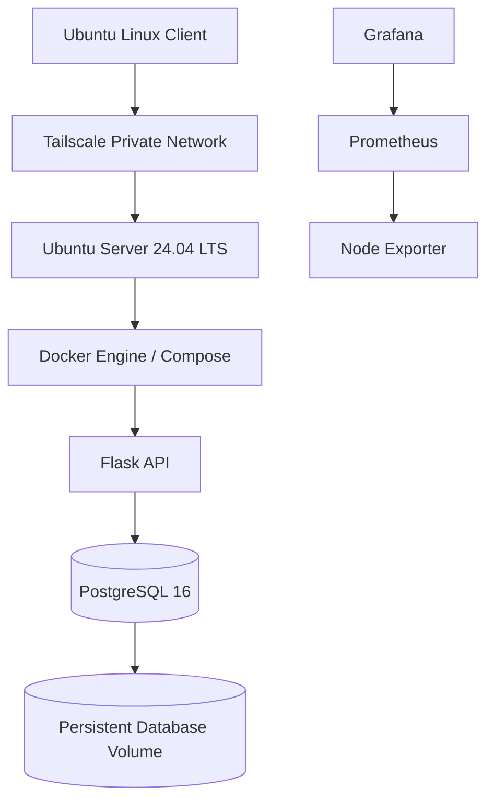
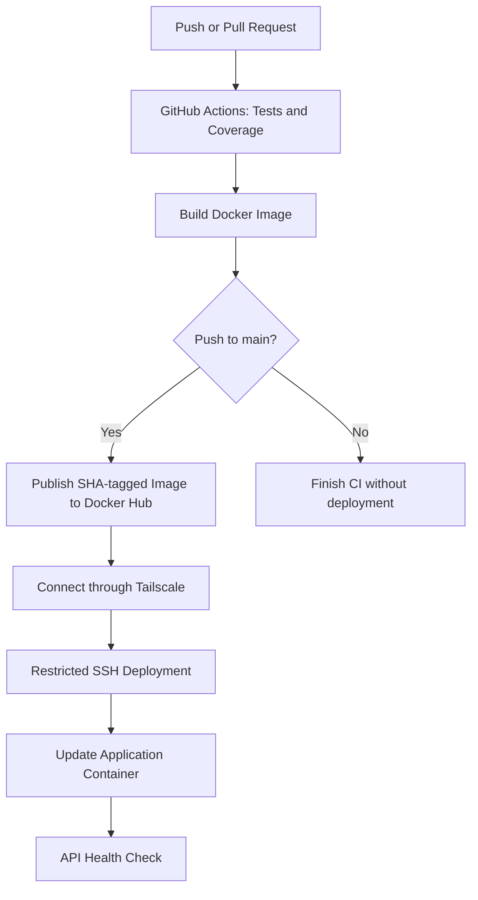

# Homelab DevOps Labs

**Build it. Test it. Break it safely. Understand why it works.**

A hands-on DevOps homelab focused on Linux administration, secure remote access, containerization, database reliability, monitoring, container security, troubleshooting, and CI/CD automation.

This repository documents practical implementation work, verification results, troubleshooting decisions, and remaining limitations.

## Project Goals

- Practice Linux server administration and troubleshooting.
- Configure secure remote access using Tailscale and SSH.
- Build and operate containerized applications with Docker and Docker Compose.
- Implement and verify PostgreSQL backup and restore procedures.
- Monitor host resources with Prometheus, Node Exporter, and Grafana.
- Scan container images for vulnerabilities and apply runtime hardening.
- Automate application testing, Docker image publishing, and homelab deployment with GitHub Actions.
- Document operational failures, recovery procedures, and security considerations.

## Architecture

### Application and Homelab

### CI/CD Deployment Flow

The CI/CD workflow runs tests and builds the Docker image for repository events. Publishing and deployment are restricted to pushes to `main`.

The deployment workflow uses Tailscale for private connectivity and a dedicated SSH key restricted to a server-side deployment script. The script accepts SHA-formatted image tags, pulls the requested image, updates the application service, and checks API health.

Private network details, credentials, and sensitive access configuration are intentionally excluded from this documentation.

## Technology Stack

| Area | Technology |
|---|---|
| Server | Ubuntu Server 24.04 LTS |
| Client | Ubuntu Linux |
| Remote access | Tailscale and SSH |
| CI/CD | GitHub Actions |
| Version control | Git and GitHub |
| Containers | Docker and Docker Compose |
| Application | Flask and Gunicorn |
| Database | PostgreSQL 16 |
| Container registry | Docker Hub |
| Container networking | Docker bridge network |
| Data persistence | Docker named volume |
| Monitoring | Prometheus and Node Exporter |
| Dashboards and alerting | Grafana and Prometheus alert rules |
| Container security | Trivy |
| Documentation | Markdown and Mermaid |

## Labs and Progress

| Lab | Status |
|---|---|
| Linux Server Administration | In progress |
| Tailscale Remote Access | Connectivity, SSH, MagicDNS, and remote-access checks completed; boot and reboot verification pending |
| Docker Networking | Implemented and documented |
| PostgreSQL Backup and Restore | Backup inspection, temporary-database restoration, data comparison, and sequence verification completed |
| Docker Compose | Application migration, health checks, runtime security controls, and data-persistence verification completed |
| Trivy Container Security | Image scanning and runtime hardening completed; vulnerability remediation and rescan pending |
| Monitoring | Prometheus, Node Exporter, and Grafana deployed; dashboard and CPU alert-rule testing completed |
| CI/CD | Initial end-to-end homelab deployment succeeded; repeat-deployment testing and recovery documentation pending |

See [ROADMAP.md](ROADMAP.md) for detailed implementation and verification status.

## CI/CD Pipeline

The workflow is defined in `.github/workflows/ci.yml`.

### 1. Continuous Integration

GitHub Actions:

- Checks out the repository.
- Sets up Python 3.12.
- Installs development dependencies.
- Runs pytest with coverage reporting.
- Builds the application Docker image.

### 2. Image Publishing

On pushes to `main`, the workflow authenticates to Docker Hub and publishes the application image.

The image repository is:

`docker.io/sufiyankhan10/homelab-notes-api`

Images receive a full Git commit SHA tag, allowing deployments to reference a specific build. The default branch also receives the `latest` tag.

### 3. Secure Deployment

For pushes to `main`, the workflow:

1. Authenticates to Tailscale using GitHub Actions identity federation.
2. Establishes connectivity to the homelab server.
3. Configures SSH using GitHub Actions secrets and strict host-key verification.
4. Invokes a restricted server-side deployment script using the requested image tag.
5. Pulls the image and updates only the application service.
6. Waits for the API health check to succeed.

The server-side script validates the requested tag before performing the deployment. The SSH key is restricted to the deployment command rather than providing a general-purpose interactive shell.

The application update uses Docker Compose without intentionally recreating dependent services. PostgreSQL data is stored separately from the application container.

### 4. Verified Deployment

The initial deployment through GitHub Actions completed successfully.

Verification on the homelab confirmed:

- The application container was running and healthy.
- The running image used the expected SHA tag.
- The API health endpoint returned `{"status":"ok"}`.
- PostgreSQL remained healthy.
- Existing notes remained accessible after deployment.
- The Prometheus, Node Exporter, and Grafana containers remained running.

These checks establish that the initial automated deployment worked. A separate test of a subsequent fresh commit pushed to `main` remains pending.

## Engineering Approach

Each lab aims to document its objective, architecture, implementation, verification, troubleshooting, security considerations, and limitations.

The project follows an evidence-based approach:

- Only verified results are described as completed.
- Planned work and known limitations remain clearly identified.
- Backup and restore procedures are tested rather than assumed to work.
- Security findings are investigated before remediation is attempted.
- Application health and data persistence are checked after changes.
- Deployment credentials are stored as GitHub Actions secrets.
- SSH host-key verification remains enabled.
- Public documentation is reviewed for secrets and sensitive infrastructure details.

## Current Issues and Next Steps

- Investigate Wi-Fi latency using measured evidence.
- Investigate and remediate reported container image vulnerabilities.
- Rebuild the image after appropriate package updates and perform a post-remediation Trivy scan.
- Configure and test monitoring alert notifications.
- Test a fresh commit pushed to `main` and verify that it triggers another successful deployment.
- Document deployment failure handling and recovery.
- Verify Tailscale startup and connectivity after a controlled server reboot.
- Review SSH authentication and access controls.

## Security

This repository is intended for sanitized documentation and safe examples.

Never commit:

- Passwords, API tokens, or other credentials.
- Private SSH keys or sensitive access configuration.
- Logs containing unnecessary sensitive information.
- Database backups containing real or private data.
- Unnecessary private network identifiers or infrastructure details.

Use least privilege, restrict unnecessary network exposure, and verify changes before applying them to running services.

See [SECURITY.md](SECURITY.md) for security guidelines.

## Roadmap

See [ROADMAP.md](ROADMAP.md) for implementation progress, pending verification, and planned milestones.

## Author

**Sufiyan Khan**

DevOps | Linux | Docker | Cloud | CI/CD