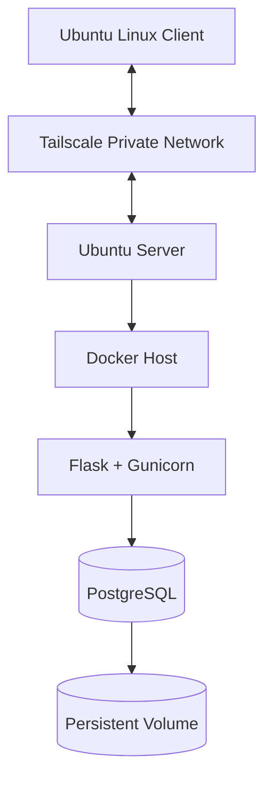

# Homelab DevOps Labs

**Build it. Test it. Break it safely. Understand why it works.**

A hands-on DevOps homelab documenting Linux administration, secure remote access, containerization, database reliability, troubleshooting, and automation.

## Project Goals

- Practice Linux server administration and troubleshooting.
- Configure secure remote access using Tailscale and SSH.
- Understand Docker networking and containerized applications.
- Implement and validate PostgreSQL backup and restore procedures.
- Deploy and verify host monitoring with Prometheus, Node Exporter, Grafana, and CPU alerting.
- Build toward CI/CD automation.

## Architecture

*Logical architecture. Private network details and credentials are intentionally omitted.*

## Technology Stack

| Area | Technology |
|---|---|
| Server | Ubuntu Server 24.04 LTS |
| Client | Ubuntu Linux |
| Remote access | Tailscale and SSH |
| Containers | Docker |
| Application | Flask and Gunicorn |
| Database | PostgreSQL |
| Networking | Docker bridge network |
| Persistence | Docker named volume |
| Monitoring | Prometheus and Node Exporter |
| Dashboards and alerting | Grafana and Prometheus alert rules |
| Documentation | Markdown and Mermaid |

## Labs and Progress

| Lab | Status |
|---|---|
| Linux Server Administration | In progress |
| Tailscale Remote Access | Connectivity and SSH tested; reboot verification pending |
| Docker Networking | Implemented and documented |
| PostgreSQL Backup and Restore | Backup, restore, data comparison, and sequence verification completed |
| Docker Compose | Migration and application verification completed |
| Trivy Container Security | Image scan and runtime hardening completed; vulnerability remediation pending |
| Monitoring | Deployed; targets, dashboard, and CPU alert tested |
| CI/CD | Planned |

## Engineering Approach

Each lab will document its objective, architecture, implementation, verification, troubleshooting, security considerations, and limitations.

Only tested results will be described as completed. Planned work will remain clearly identified as planned.

## Current Issues

- Investigate Wi-Fi latency using measured evidence.
- Investigate and remediate the reported container image vulnerabilities.
- Perform and document a post-remediation Trivy scan.
- Configure and test monitoring alert notifications.
- Implement CI/CD automation with automated testing and a controlled deployment workflow.

## Security

This repository is intended for sanitized documentation and safe examples.

Never commit credentials, private keys, sensitive logs, database backups containing real data, or unnecessary infrastructure identifiers.

See [SECURITY.md](SECURITY.md) for security guidelines.

## Roadmap

See [ROADMAP.md](ROADMAP.md) for planned milestones.

## Author

**Sufiyan Khan**

DevOps | Linux | Docker | Cloud | CI/CD
