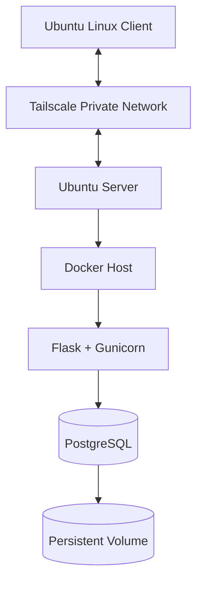

# Homelab DevOps Labs

**Build it. Test it. Break it safely. Understand why it works.**

A hands-on DevOps homelab documenting Linux administration, secure remote access, containerization, database reliability, monitoring, container security, troubleshooting, and automation.

## Project Goals

- Practice Linux server administration and troubleshooting.
- Configure secure remote access using Tailscale and SSH.
- Understand Docker networking and containerized applications.
- Implement and validate PostgreSQL backup and restore procedures.
- Deploy and verify host monitoring with Prometheus, Node Exporter, Grafana, and CPU alerting.
- Scan container images for vulnerabilities and apply runtime hardening.
- Build toward CI/CD automation with automated testing and controlled deployments.

## Architecture

*Logical application architecture. Private network details and credentials are intentionally omitted. Monitoring and security tooling are documented separately in their respective labs.*

## Technology Stack

| Area | Technology |
|---|---|
| Server | Ubuntu Server 24.04 LTS |
| Client | Ubuntu Linux |
| Remote access | Tailscale and SSH |
| Containers | Docker and Docker Compose |
| Application | Flask and Gunicorn |
| Database | PostgreSQL |
| Networking | Docker bridge network |
| Persistence | Docker named volume |
| Monitoring | Prometheus and Node Exporter |
| Dashboards and alerting | Grafana and Prometheus alert rules |
| Container security | Trivy |
| Documentation | Markdown and Mermaid |
| Version control | Git and GitHub |

## Labs and Progress

| Lab | Status |
|---|---|
| Linux Server Administration | In progress |
| Tailscale Remote Access | Connectivity, SSH, MagicDNS, and post-reboot access verified |
| Docker Networking | Implemented and documented |
| PostgreSQL Backup and Restore | Backup, restore, data comparison, and sequence verification completed |
| Docker Compose | Migration, health checks, security controls, and application verification completed |
| Trivy Container Security | Image scan and runtime hardening completed; vulnerability remediation pending |
| Monitoring | Deployed; scrape targets and dashboard verified; CPU alert lifecycle tested |
| CI/CD | Planned |

## Engineering Approach

Each lab aims to document its objective, architecture, implementation, verification, troubleshooting, security considerations, and limitations.

The project follows an evidence-based approach:

- Only verified results are described as completed.
- Planned work and known limitations remain clearly identified.
- Backup and restore procedures are tested rather than assumed to work.
- Security findings are investigated before remediation is attempted.
- Changes are validated before being treated as successful.
- Public documentation is reviewed for secrets and sensitive infrastructure details.

## Current Issues

- Investigate Wi-Fi latency using measured evidence.
- Investigate and remediate the reported container image vulnerabilities.
- Perform and document a post-remediation Trivy scan.
- Configure and test monitoring alert notifications.
- Implement CI/CD automation with automated testing and a controlled deployment workflow.

## Security

This repository is intended for sanitized documentation and safe examples.

Never commit:

- Passwords, API tokens, or other credentials.
- Private SSH keys or sensitive access configuration.
- Logs containing unnecessary sensitive information.
- Database backups containing real or private data.
- Unnecessary private network identifiers or infrastructure details.

Use least privilege, restrict unnecessary network exposure, and verify changes before applying them to running services.

See [SECURITY.md](SECURITY.md) for security guidelines.

## Roadmap

See [ROADMAP.md](ROADMAP.md) for implementation progress, pending verification, and planned milestones.

## Author

**Sufiyan Khan**

DevOps | Linux | Docker | Cloud | CI/CD
