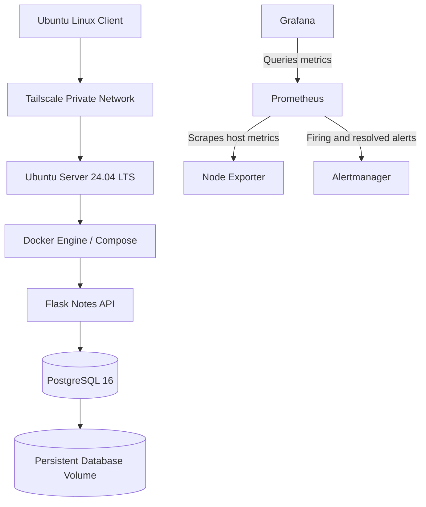
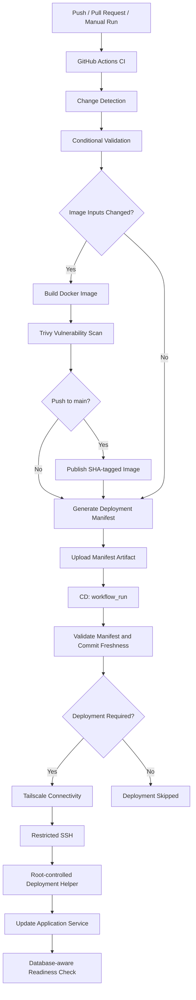

# Homelab DevOps Labs

**Build it. Test it. Break it safely. Understand why it works.**

A hands-on DevOps homelab focused on Linux administration, secure remote access, containerization, database reliability, monitoring, container security, troubleshooting, and CI/CD automation.

This repository documents practical implementation work, architecture decisions, verification results, troubleshooting, and known limitations.

The homelab is a learning environment, not a production service.

## Project Goals

- Develop practical Linux server administration and troubleshooting skills.
- Configure secure remote access using Tailscale and SSH.
- Build and operate containerized applications with Docker and Docker Compose.
- Implement and verify PostgreSQL backup and restore procedures.
- Monitor host resources using Prometheus, Node Exporter, Grafana, and Alertmanager.
- Scan container images for vulnerabilities and apply runtime hardening.
- Automate application testing, Docker image publishing, and homelab deployment using GitHub Actions.
- Practice deployment verification, failure handling, and recovery.
- Document implementation decisions, operational issues, and security considerations.

## Architecture

### Application and Homelab



Node Exporter exposes host-level metrics through its `/metrics` endpoint. Prometheus periodically scrapes this endpoint and stores the collected metrics.

Grafana queries Prometheus using PromQL to retrieve and visualize metrics in dashboards. Prometheus also evaluates alert rules and forwards alert state changes to Alertmanager for notification handling.

### CI/CD Deployment Flow



CI and CD are maintained as separate GitHub Actions workflows. CI performs applicable validation and conditionally builds and publishes the application image. For pushes to `main`, it also generates a deployment manifest. CD validates that manifest and checks commit freshness before deciding whether deployment should proceed.

A deployment is not requested for changes that do not require a new application image.

## Technology Stack

| Area | Technology |
|---|---|
| Server | Ubuntu Server 24.04 LTS |
| Client | Ubuntu Linux |
| Remote access | Tailscale and SSH |
| CI/CD | GitHub Actions |
| Version control | Git and GitHub |
| Containers | Docker and Docker Compose |
| Application | Flask and Gunicorn |
| Database | PostgreSQL 16 |
| Container registry | Docker Hub |
| Container networking | Docker bridge network |
| Data persistence | Docker named volumes |
| Monitoring | Prometheus and Node Exporter |
| Alert management | Alertmanager |
| Dashboards and visualization | Grafana |
| Container security | Trivy |
| Documentation | Markdown and Mermaid |

## Labs and Progress

| Lab | Status |
|---|---|
| Linux Server Administration | Implemented; ongoing troubleshooting and learning |
| Tailscale Remote Access | Connectivity, SSH, MagicDNS, startup, and reboot verification completed |
| Docker Networking | Implemented and documented |
| PostgreSQL Backup and Restore | Custom-format backups, isolated restoration, data comparison, and sequence verification completed |
| Docker Compose | Application migration, health checks, runtime security controls, and end-to-end image-changing CI/CD deployment verified |
| Trivy Container Security | Historical image scanning and runtime hardening completed; vulnerability remediation and post-remediation scan pending |
| Monitoring | Prometheus, Node Exporter, Grafana, Alertmanager, dashboard, and alert testing completed |
| CI/CD | Separate CI/CD workflows, conditional validation, image publishing, deployment manifest, stale-commit checks, restricted deployment, and controlled rollback testing completed |

See [ROADMAP.md](ROADMAP.md) for detailed implementation and verification status.

## CI/CD Pipeline

The CI and CD workflows are maintained separately:

```text
.github/workflows/ci.yml
.github/workflows/cd.yml
```

### Continuous Integration

The CI workflow supports pushes, pull requests, and manual execution. Its path filters cover:

- `labs/05-docker-compose/**`
- `.github/workflows/ci.yml`
- `.github/workflows/cd.yml`

A change-detection job identifies which parts of the application or its supporting configuration have changed. Subsequent jobs run conditionally rather than executing every validation step for every change.

Depending on the changed files, CI can perform:

- Python dependency lock-file validation using pip-tools.
- Automated pytest execution with coverage reporting.
- Docker Compose configuration validation.
- Bash syntax validation for the PostgreSQL backup script.
- Docker image building using Docker Buildx.
- Trivy vulnerability scanning of the built image.

The image build uses a full Git commit SHA tag. On the default branch, the `latest` tag is also generated.

Trivy is configured to fail the image scan for reported HIGH and CRITICAL vulnerabilities. Unfixed vulnerabilities are excluded from the configured scan.

Docker Hub publishing occurs only when all relevant image-building and scanning steps succeed, the event is a push, and the branch is `main`.

Pull requests and non-main pushes can run applicable validation, but do not publish production images or request homelab deployment.

**Documentation handling:** Changes to the Lab 05 README can trigger CI because the file is within its configured path. The change classifier skips unrelated validation and image-building jobs. Root-level README and roadmap changes alone do not match the configured CI paths.

### Deployment Manifest and CD

For pushes to `main`, CI generates a JSON deployment manifest and uploads it as a workflow artifact.

The manifest records:

- Schema version.
- Repository identity.
- Full commit SHA.
- Whether deployment is required.
- Exact SHA-tagged image reference, when deployment is required.

For changes that do not require a new application image, the manifest records that deployment is not required.

The CD workflow starts after CI completes. Before deployment, it:

1. Confirms that the CI workflow succeeded and was triggered by a push to `main` in the expected repository.
2. Downloads the manifest associated with that CI run.
3. Validates the manifest's structure, repository, commit SHA, deployment flag, and image reference.
4. Checks whether the CI commit is still current relative to `main`.
5. Skips deployment if a newer image-relevant change makes the requested deployment stale.
6. Proceeds only when the manifest requests deployment and the freshness checks pass.

A final freshness check runs immediately before the remote deployment steps. This reduces the chance of deploying an outdated image, although a race between the final GitHub check and the server-side command is still possible.

### Secure Deployment

When deployment is required, the CD workflow:

1. Uses GitHub Actions identity federation to authenticate to Tailscale.
2. Establishes private connectivity to the homelab server.
3. Configures SSH with strict host-key verification.
4. Uses a restricted deployment account.
5. Sends only the validated SHA-tagged deployment identifier.
6. Invokes a server-side deployment wrapper.
7. Uses a root-controlled deployment helper to update the application.

The deployment account does not require membership in the Docker or sudo groups.

SSH access is restricted to a specific deployment command rather than providing a general-purpose interactive shell.

The server-side deployment helper:

- Validates the requested full SHA-tagged image identifier.
- Checks that the image belongs to the expected application repository.
- Pulls the requested image.
- Updates only the application service through Docker Compose.
- Verifies that the expected image is running.
- Checks the database-aware readiness endpoint.
- Contains rollback logic to attempt restoration of the previous image if deployment verification fails.

The application is updated without explicitly recreating the PostgreSQL service or deleting its persistent storage.

### Deployment Verification

The hardened workflow has successfully completed an image-changing CI/CD run triggered by a dependency lockfile update.

The verified process included:

- Application tests and dependency lock-file validation.
- Docker image build.
- Trivy installation and checksum verification.
- Vulnerability scanning of the built image.
- Docker Hub publishing.
- Deployment manifest generation and validation.
- CD freshness checks.
- Tailscale connectivity and restricted SSH deployment.
- Deployment of the exact SHA-tagged image produced by CI.
- Post-deployment application health and readiness checks.

Both CI and CD completed successfully.

The deployed application returned:

| Endpoint | Result |
|---|---|
| `/health` | HTTP 200 — `{"status":"ok"}` |
| `/ready` | HTTP 200 — `{"status":"ready"}` |

The deployed image reference was checked against the expected SHA-tagged image. The application and PostgreSQL containers were also reported healthy.

A controlled rollback test was performed using a deliberately triggered health-verification failure. The rollback path was exercised to verify recovery behavior.

**Verification distinction:** The successful image-changing run was triggered by a dependency lockfile change, not a direct `app.py` change. It nevertheless exercised the complete image build, scan, publish, and remote deployment path.

See [Lab 05: Docker Compose](labs/05-docker-compose/README.md) for implementation and verification details.

## PostgreSQL Backup and Restore

PostgreSQL backup and recovery are treated as separate operational tasks. A successful backup command alone does not establish that data can be recovered.

Implemented work includes:

- Custom-format backups using `pg_dump`.
- Backup archive inspection using `pg_restore`.
- Restoration into isolated temporary databases.
- Comparison of restored records and checksums.
- Sequence-state verification.
- Backup validation and retention controls.
- Root-owned backup automation using a systemd oneshot service.

The current backup automation uses:

- PostgreSQL readiness checks.
- Custom-format archive creation.
- Concurrency protection using `flock`.
- Temporary files and atomic replacement.
- Archive validation.
- Retention of the seven newest matching backups.
- A daily success marker to avoid duplicate successful backups on the same day.

The service runs after server startup with a five-minute delay. It is not a guaranteed daily scheduler if the server remains online for multiple days.

The latest verified backup archive was created on November 7, 2026. Its custom-format archive listing was validated successfully using `pg_restore --list`.

Seven archives were retained at the time of inspection. This should not be interpreted as seven consecutive daily backups.

Separate isolated restore tests verified restored data and sequence state using historical backups. A later restore test also confirmed recovered row counts without modifying the running application database.

**Known limitations:**

- Backups are stored locally rather than in off-host storage.
- Startup-triggered execution does not guarantee daily backups during continuous uptime.
- Failure notification and automated retry handling remain improvement opportunities.

See [Lab 04: PostgreSQL Backup and Restore](labs/04-postgresql-backup-restore/README.md) and the [Backup Automation Guide](docs/postgres-backup-automation.md).

## Monitoring

The monitoring stack consists of:

- **Prometheus:** Metrics collection, time-series storage, and alert-rule evaluation.
- **Node Exporter:** Host-level metrics.
- **Grafana:** Dashboards and visualization.
- **Alertmanager:** Alert routing and notification delivery.

Prometheus scrapes itself and Node Exporter. Grafana queries Prometheus for dashboard data.

Prometheus and Grafana web interfaces are bound to localhost and accessed remotely through SSH tunnels.

Verification includes:

- Prometheus scrape-target checks.
- Node Exporter metrics collection.
- Grafana data-source and dashboard configuration.
- Node Exporter Full dashboard verification.
- CPU alert-rule validation.
- Pending-to-firing alert-state testing through a controlled threshold simulation.
- Alertmanager target-down notification testing.

The configured CPU alert triggers when average CPU usage exceeds 80% for five minutes.

A controlled Node Exporter-down test verified both notification stages:

- A firing notification was received when the monitoring target became unavailable.
- A recovery notification was received after the target became available again.

**Verification distinction:** CPU alert lifecycle testing and target-down notification testing were separate tests. Successful notification delivery for the CPU alert itself is not claimed.

The current environment is a single-server learning setup and does not provide high availability.

See [Lab 07: Monitoring](labs/07-monitoring/README.md) for configuration and verification details.

## Container Security

Trivy is used to scan application images for reported vulnerabilities. The project also covers container runtime hardening and Docker configuration review.

A historical scan of the `notes-app:3` image on October 17, 2026, reported:

- 44 HIGH findings.
- 0 CRITICAL findings.
- 8 unique CVEs.
- All 44 HIGH findings were associated with operating-system packages.
- No HIGH or CRITICAL Python dependency findings.

These results describe that specific historical image scan, not necessarily the current image.

Trivy scanning is also integrated into the Lab 05 CI workflow. Changed application images are scanned before Docker Hub publishing.

Runtime hardening includes:

- A dedicated non-root application user.
- A read-only root filesystem.
- Restricted Linux capabilities.
- `no-new-privileges`.
- A constrained temporary filesystem.

**Remaining work:** Investigate applicable vendor fixes, rebuild the image after appropriate package updates, and perform a post-remediation scan.

See [Lab 06: Trivy Container Security](labs/06-trivy-container-security/README.md) for historical findings and hardening details.

## Engineering Approach

Each lab aims to document:

- Objective and problem statement.
- Architecture and implementation.
- Commands and configuration decisions.
- Verification results.
- Troubleshooting and root-cause analysis.
- Security considerations.
- Known limitations and future improvements.

The project follows an evidence-based approach:

- Only verified results are described as completed.
- Planned work and known limitations remain clearly identified.
- Backup and restore procedures are tested rather than assumed to work.
- Historical security findings are distinguished from current image status.
- Application readiness and data persistence are checked after changes.
- Deployment credentials are stored as GitHub Actions secrets.
- SSH host-key verification remains enabled.
- Least-privilege access is preferred for remote deployment.
- Public documentation is reviewed for secrets and sensitive infrastructure details.

## Current Issues and Next Steps

- Investigate Wi-Fi latency using measured evidence.
- Investigate and remediate reported container image vulnerabilities.
- Rebuild the application image and perform a post-remediation Trivy scan.
- Verify a direct application-code change through the full CI/CD pipeline.
- Test CPU alert notification delivery independently.
- Evaluate off-host PostgreSQL backup storage.
- Improve backup failure notification and recovery handling.
- Expand integration testing against a real PostgreSQL instance.
- Consider stronger server-side protection against stale deployments.
- Review third-party GitHub Actions pinning and supply-chain security.

## Security

This repository is intended for sanitized documentation and safe examples.

Never commit:

- Passwords, API tokens, or other credentials.
- Private SSH keys or sensitive access configuration.
- Logs containing unnecessary sensitive information.
- Database backups containing real or private data.
- Unnecessary private network identifiers or infrastructure details.

Use least privilege, restrict unnecessary network exposure, and verify changes before applying them to running services.

See [SECURITY.md](SECURITY.md) for security guidelines.

## Roadmap

See [ROADMAP.md](ROADMAP.md) for implementation progress, pending verification, and planned milestones.

## Author

**Sufiyan Khan**

DevOps | Linux | Docker | Cloud | CI/CD
