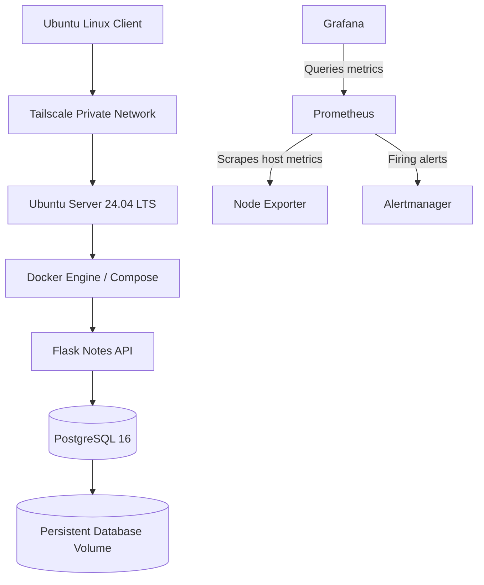
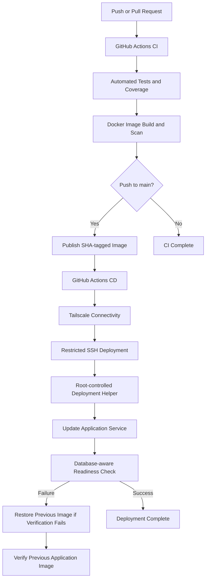

# Homelab DevOps Labs

**Build it. Test it. Break it safely. Understand why it works.**

A hands-on DevOps homelab focused on Linux administration, secure remote access, containerization, database reliability, monitoring, container security, troubleshooting, and CI/CD automation.

This repository documents practical implementation work, architecture decisions, verification results, troubleshooting, and known limitations.

The homelab is a learning environment, not a production service.

## Project Goals

- Develop practical Linux server administration and troubleshooting skills.
- Configure secure remote access using Tailscale and SSH.
- Build and operate containerized applications with Docker and Docker Compose.
- Implement and verify PostgreSQL backup and restore procedures.
- Monitor host resources using Prometheus, Node Exporter, Grafana, and Alertmanager.
- Scan container images for vulnerabilities and apply runtime hardening.
- Automate application testing, Docker image publishing, and homelab deployment using GitHub Actions.
- Practice deployment verification, failure handling, and recovery.
- Document implementation decisions, operational issues, and security considerations.

## Architecture

### Application and Homelab



Node Exporter exposes host-level metrics through its `/metrics` endpoint. Prometheus periodically scrapes this endpoint and stores the collected metrics.

Grafana queries Prometheus using PromQL to retrieve and visualize metrics in dashboards. Prometheus also evaluates alert rules and forwards firing alerts to Alertmanager for notification handling.

### CI/CD Deployment Flow



CI and CD are maintained as separate GitHub Actions workflows. CI validates the application and builds the image, while CD handles deployment after successful CI on the default branch.

## Technology Stack

| Area | Technology |
|---|---|
| Server | Ubuntu Server 24.04 LTS |
| Client | Ubuntu Linux |
| Remote access | Tailscale and SSH |
| CI/CD | GitHub Actions |
| Version control | Git and GitHub |
| Containers | Docker and Docker Compose |
| Application | Flask and Gunicorn |
| Database | PostgreSQL 16 |
| Container registry | Docker Hub |
| Container networking | Docker bridge network |
| Data persistence | Docker named volumes |
| Monitoring | Prometheus and Node Exporter |
| Alert management | Alertmanager |
| Dashboards and visualization | Grafana |
| Container security | Trivy |
| Documentation | Markdown and Mermaid |

## Labs and Progress

| Lab | Status |
|---|---|
| Linux Server Administration | Implemented; ongoing troubleshooting and learning |
| Tailscale Remote Access | Connectivity, SSH, MagicDNS, startup, and reboot verification completed |
| Docker Networking | Implemented and documented |
| PostgreSQL Backup and Restore | Custom-format backups, isolated restoration, data comparison, and sequence verification completed |
| Docker Compose | Application migration, health checks, runtime security controls, and persistence verification completed |
| Trivy Container Security | Historical image scanning and runtime hardening completed; vulnerability remediation and rescan pending |
| Monitoring | Prometheus, Node Exporter, Grafana, Alertmanager, dashboard, and alert testing completed |
| CI/CD | Automated deployment, readiness verification, restricted deployment access, and controlled rollback testing completed |

See [ROADMAP.md](ROADMAP.md) for detailed implementation and verification status.

## CI/CD Pipeline

The CI and CD workflows are maintained separately:

```text
.github/workflows/ci.yml
.github/workflows/cd.yml
```

### Continuous Integration

For applicable pushes and pull requests, GitHub Actions:

- Checks out the repository.
- Sets up Python 3.12.
- Installs development dependencies.
- Runs pytest with coverage reporting.
- Builds the application Docker image.
- Runs the configured Trivy image scan.
- Publishes the image to Docker Hub on pushes to `main`.

Published images receive a full Git commit SHA tag. The default branch also receives the `latest` tag.

Pull requests and non-main pushes run applicable validation without publishing or deploying the application image.

Markdown-only changes are excluded through workflow path filtering. Changes containing both documentation and relevant application files still trigger CI.

The application tests cover health and readiness responses, notes retrieval, note insertion, database error handling, and environment-based database configuration.

Database connections are mocked in the unit tests. They do not replace integration testing against a running PostgreSQL instance.

### Secure Deployment

After successful CI on `main`, the CD workflow:

1. Authenticates to Tailscale using GitHub Actions identity federation.
2. Establishes private connectivity to the homelab server.
3. Configures SSH with strict host-key verification.
4. Uses a restricted deployment account.
5. Invokes a server-side deployment wrapper.
6. Updates the application using a root-controlled deployment helper.
7. Verifies application readiness.

The deployment account does not require membership in the Docker or sudo groups.

SSH access is restricted to a specific deployment command rather than providing a general-purpose interactive shell.

The server-side deployment helper:

- Validates the requested full SHA-tagged image identifier.
- Checks that the image belongs to the expected application repository.
- Pulls the requested image.
- Updates only the application service through Docker Compose.
- Verifies that the expected image is running.
- Checks the database-aware readiness endpoint.
- Attempts to restore the previous image if deployment verification fails.

The application is updated without explicitly recreating the PostgreSQL service or deleting its persistent storage.

### Deployment Verification

The automated deployment process has been successfully verified using SHA-tagged Docker images.

Verification includes:

- Successful CI and CD workflow execution.
- Private connectivity through Tailscale.
- Restricted SSH deployment access.
- Server-side image validation and deployment.
- Application readiness verification.
- Confirmation of the expected running image.
- PostgreSQL remaining available during application-only updates.

The deployment helper's rollback mechanism was also tested by deliberately triggering a health-verification failure. The previous application image was restored and its health verified.

This was a controlled rollback test, not a real application regression.

The deployment readiness endpoint is `/ready`, which checks application readiness, including database connectivity.

The `/health` endpoint serves a different purpose: it confirms that the API is responding but does not independently establish database availability.

## PostgreSQL Backup and Restore

PostgreSQL backup and recovery are treated as separate operational tasks. A successful backup command alone does not establish that data can be recovered.

Implemented work includes:

- Custom-format backups using `pg_dump`.
- Backup archive inspection using `pg_restore`.
- Restoration into isolated temporary databases.
- Comparison of restored records and checksums.
- Sequence-state verification.
- Backup validation and retention controls.
- Root-owned backup automation using a systemd oneshot service.

The current backup automation uses:

- PostgreSQL readiness checks.
- Custom-format archive creation.
- Concurrency protection using `flock`.
- Temporary files and atomic replacement.
- Archive validation.
- Retention of the seven newest matching backups.
- A daily success marker to avoid duplicate successful backups on the same day.

The service runs after server startup with a five-minute delay. It is not a guaranteed daily scheduler if the server remains online for multiple days.

Separate isolated restore tests verified restored data and sequence state using historical backups. A later restore test also confirmed recovered row counts without modifying the running application database.

**Known limitations:**

- Backups are stored locally rather than in off-host storage.
- Startup-triggered execution does not guarantee daily backups during continuous uptime.
- Failure notification and automated retry handling remain improvement opportunities.

See [Lab 04: PostgreSQL Backup and Restore](labs/04-postgresql-backup-restore/README.md) and the [Backup Automation Guide](docs/postgres-backup-automation.md).

## Monitoring

The monitoring stack consists of:

- **Prometheus:** Metrics collection, time-series storage, and alert-rule evaluation.
- **Node Exporter:** Host-level metrics.
- **Grafana:** Dashboards and visualization.
- **Alertmanager:** Alert routing and notification delivery.

Prometheus scrapes itself and Node Exporter. Grafana queries Prometheus for dashboard data.

Prometheus and Grafana web interfaces are bound to localhost and accessed remotely through SSH tunnels.

Verification includes:

- Prometheus scrape-target checks.
- Node Exporter metrics collection.
- Grafana data-source and dashboard configuration.
- Node Exporter Full dashboard verification.
- CPU alert-rule validation.
- Pending-to-firing alert-state testing through a controlled threshold simulation.
- Alertmanager notification delivery testing.

The configured CPU alert triggers when average CPU usage exceeds 80% for five minutes.

A notification was successfully received for a Prometheus target-down alert.

**Verification distinction:** CPU alert lifecycle testing and target-down notification testing were separate tests. Successful notification delivery for the CPU alert itself is not claimed.

The current environment is a single-server learning setup and does not provide high availability.

See [Lab 07: Monitoring](labs/07-monitoring/README.md) for configuration and verification details.

## Container Security

Trivy is used to scan application images for reported vulnerabilities. The project also covers container runtime hardening and Docker configuration review.

A historical scan of the `notes-app:3` image on October 17, 2026, reported:

- 44 HIGH findings.
- 0 CRITICAL findings.
- 8 unique CVEs.
- All 44 HIGH findings were associated with operating-system packages.
- No HIGH or CRITICAL Python dependency findings.

These results describe that specific historical image scan, not necessarily the current image.

Runtime hardening includes:

- A dedicated non-root application user.
- A read-only root filesystem.
- Restricted Linux capabilities.
- `no-new-privileges`.
- A constrained temporary filesystem.

**Remaining work:** Investigate applicable vendor fixes, rebuild the image after appropriate package updates, and perform a post-remediation scan.

See [Lab 06: Trivy Container Security](labs/06-trivy-container-security/README.md) for historical findings and hardening details.

## Engineering Approach

Each lab aims to document:

- Objective and problem statement.
- Architecture and implementation.
- Commands and configuration decisions.
- Verification results.
- Troubleshooting and root-cause analysis.
- Security considerations.
- Known limitations and future improvements.

The project follows an evidence-based approach:

- Only verified results are described as completed.
- Planned work and known limitations remain clearly identified.
- Backup and restore procedures are tested rather than assumed to work.
- Historical security findings are distinguished from current image status.
- Application readiness and data persistence are checked after changes.
- Deployment credentials are stored as GitHub Actions secrets.
- SSH host-key verification remains enabled.
- Least-privilege access is preferred for remote deployment.
- Public documentation is reviewed for secrets and sensitive infrastructure details.

## Current Issues and Next Steps

- Investigate Wi-Fi latency using measured evidence.
- Investigate and remediate reported container image vulnerabilities.
- Rebuild the application image and perform a post-remediation Trivy scan.
- Expand monitoring coverage for application and PostgreSQL services.
- Test CPU alert notification delivery independently.
- Evaluate off-host PostgreSQL backup storage.
- Improve backup failure notification and recovery handling.
- Continue testing deployment rollback under different failure scenarios.
- Expand integration testing against a real PostgreSQL instance.

## Security

This repository is intended for sanitized documentation and safe examples.

Never commit:

- Passwords, API tokens, or other credentials.
- Private SSH keys or sensitive access configuration.
- Logs containing unnecessary sensitive information.
- Database backups containing real or private data.
- Unnecessary private network identifiers or infrastructure details.

Use least privilege, restrict unnecessary network exposure, and verify changes before applying them to running services.

See [SECURITY.md](SECURITY.md) for security guidelines.

## Roadmap

See [ROADMAP.md](ROADMAP.md) for implementation progress, pending verification, and planned milestones.

## Author

**Sufiyan Khan**

DevOps | Linux | Docker | Cloud | CI/CD
