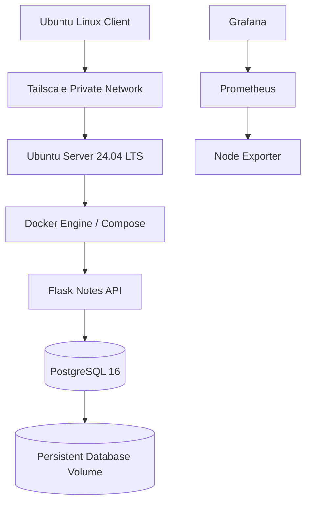
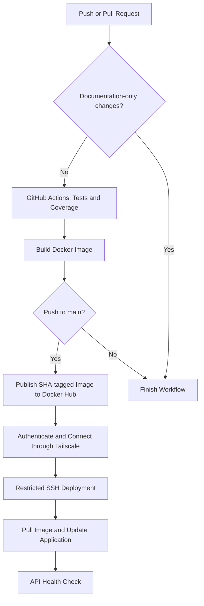

# Homelab DevOps Labs

**Build it. Test it. Break it safely. Understand why it works.**

A hands-on DevOps homelab focused on Linux administration, secure remote access, containerization, database reliability, monitoring, container security, troubleshooting, and CI/CD automation.

This repository documents practical implementation work, architecture decisions, verification results, troubleshooting, and known limitations. The homelab is a learning environment, not a production service.

## Project Goals

- Develop practical Linux server administration and troubleshooting skills.
- Configure secure remote access using Tailscale and SSH.
- Build and operate containerized applications with Docker and Docker Compose.
- Implement and verify PostgreSQL backup and restore procedures.
- Monitor host resources using Prometheus, Node Exporter, and Grafana.
- Scan container images for vulnerabilities and apply runtime hardening.
- Automate application testing, Docker image publishing, and homelab deployment using GitHub Actions.
- Practice deployment verification, failure handling, and recovery.
- Document implementation decisions, operational issues, and security considerations.

## Architecture

### Application and Homelab



### CI/CD Deployment Flow



The CI/CD workflow runs automated tests and builds the application image for applicable repository events. Markdown-only changes are excluded through GitHub Actions path filtering.

Image publishing and deployment are restricted to pushes to `main`. Pull requests run the applicable CI checks but do not publish or deploy the application.

The deployment process uses Tailscale for private connectivity and a dedicated SSH key restricted to a server-side deployment script. The script validates the requested image tag, pulls the corresponding image, updates the application service, and checks API health.

Private network details, credentials, and sensitive access configuration are intentionally excluded from this documentation.

## Technology Stack

| Area | Technology |
|---|---|
| Server | Ubuntu Server 24.04 LTS |
| Client | Ubuntu Linux |
| Remote access | Tailscale and SSH |
| CI/CD | GitHub Actions |
| Version control | Git and GitHub |
| Containers | Docker and Docker Compose |
| Application | Flask and Gunicorn |
| Database | PostgreSQL 16 |
| Container registry | Docker Hub |
| Container networking | Docker bridge network |
| Data persistence | Docker named volume |
| Monitoring | Prometheus and Node Exporter |
| Dashboards and alert rules | Grafana and Prometheus |
| Container security | Trivy |
| Documentation | Markdown and Mermaid |

## Labs and Progress

| Lab | Status |
|---|---|
| Linux Server Administration | In progress |
| Tailscale Remote Access | Tailscale connectivity, SSH, MagicDNS, startup, and reboot verification completed |
| Docker Networking | Implemented and documented |
| PostgreSQL Backup and Restore | Custom-format backup inspection, isolated database restoration, data comparison, and sequence verification completed |
| Docker Compose | Application migration, health checks, runtime security controls, and data-persistence verification completed |
| Trivy Container Security | Image scanning and runtime hardening completed; vulnerability remediation and rescan pending |
| Monitoring | Prometheus, Node Exporter, and Grafana deployed; dashboard and CPU alert-rule testing completed |
| CI/CD | Two successful automated deployments verified; application-code deployment testing and failure-recovery work pending |

See [ROADMAP.md](ROADMAP.md) for detailed implementation and verification status.

## CI/CD Pipeline

The workflow is defined in `.github/workflows/ci.yml`.

### 1. Continuous Integration

GitHub Actions performs the following steps for applicable pushes and pull requests:

- Checks out the repository.
- Sets up Python 3.12.
- Installs development dependencies.
- Runs pytest with coverage reporting.
- Builds the application Docker image.

Markdown-only changes are excluded using `paths-ignore` for both push and pull-request events.

If a change includes both Markdown and application files, the workflow still runs.

### 2. Image Publishing

On pushes to `main`, the workflow authenticates to Docker Hub and publishes the application image.

The image repository is:

`docker.io/sufiyankhan10/homelab-notes-api`

Published images receive a full Git commit SHA tag, allowing deployments to reference a specific build. The default branch also receives the `latest` tag.

SHA-based tags provide an identifiable reference to the image built from a particular commit.

### 3. Secure Deployment

For successful pushes to `main`, the workflow:

1. Authenticates to Tailscale using GitHub Actions identity federation.
2. Establishes private connectivity to the homelab server.
3. Configures SSH using GitHub Actions secrets and strict host-key verification.
4. Invokes a restricted server-side deployment script with the requested image tag.
5. Pulls the image and updates the application service through Docker Compose.
6. Waits for the API health check to succeed.

The server-side script validates the requested tag before performing the deployment.

The deployment SSH key is restricted to the server-side deployment command rather than providing a general-purpose interactive shell.

The application update targets the application service without intentionally recreating the PostgreSQL service. Database data is stored separately from the application container using a persistent Docker volume.

### 4. Deployment Verification

Two automated deployments through GitHub Actions have completed successfully.

The initial deployment verified the end-to-end deployment process, including image publishing, private connectivity, restricted SSH access, application update, and API health.

A subsequent deployment was also completed successfully using the image tagged with commit:

`73d5182683bc265d0fb8704804fb3e574cb961ee`

The subsequent deployment followed a CI/CD workflow configuration change.

Post-deployment verification on the homelab confirmed:

- The application container was running and reported healthy.
- The running application used the expected commit-SHA image.
- The API health endpoint returned HTTP `200 OK`.
- The health response was `{"status":"ok"}`.
- The notes endpoint returned both existing records.
- PostgreSQL remained healthy.
- The PostgreSQL container was not recreated during the application update.
- Prometheus, Node Exporter, and Grafana remained running.

The existing application records remained accessible:

```json
[
  {
    "id": 1,
    "txt": "survives container delete"
  },
  {
    "id": 34,
    "txt": "Docker network DNS works"
  }
]
```

These checks establish that both automated deployments completed successfully and that existing application data remained accessible.

**Known limitation:** The subsequent deployment used a workflow-configuration commit rather than an application-code change. A separate deployment triggered by a fresh application-code commit is still pending.

Automatic rollback and deployment failure recovery have also not yet been implemented and verified.

## PostgreSQL Backup and Restore

PostgreSQL backup and recovery are treated as separate operational tasks rather than assuming that a successful backup command guarantees recoverability.

The project includes:

- Custom-format PostgreSQL backups using `pg_dump`.
- Backup archive inspection using `pg_restore`.
- Restoration into an isolated temporary database.
- Comparison of restored records and checksums.
- Sequence-state verification.
- Backup validation and retention controls.

An isolated restoration test confirmed that the restored records matched the source data and that the sequence state was preserved.

The startup-triggered backup service has also been tested after a server reboot.

**Known limitation:** The startup-triggered backup service is not a guaranteed daily scheduler. Failure notifications and automated retry handling remain future improvements.

See the relevant lab documentation for implementation details and verification results.

## Monitoring

The homelab monitoring stack consists of:

- Prometheus for metrics collection and alert-rule evaluation.
- Node Exporter for host-level metrics.
- Grafana for dashboards and visualization.

The monitoring services are bound to localhost rather than exposed directly to the public network.

Verification includes:

- Prometheus scrape-target checks.
- Node Exporter metrics collection.
- Grafana dashboard configuration.
- Host CPU alert-rule validation.
- Pending-to-firing alert-state testing through a controlled threshold simulation.

**Known limitations:** Alert notification delivery has not yet been configured. The current setup is a single-host learning environment rather than a highly available monitoring platform.

## Container Security

Trivy is used to scan container images for reported vulnerabilities.

The project also covers container runtime hardening and Docker configuration review.

Completed work includes image scanning, investigation of reported findings, and runtime security improvements.

**Remaining work:** Remediate applicable image vulnerabilities, rebuild the image, and perform a post-remediation scan to verify the results.

## Engineering Approach

Each lab aims to document:

- Objective and problem statement.
- Architecture and implementation.
- Commands and configuration decisions.
- Verification results.
- Troubleshooting and root-cause analysis.
- Security considerations.
- Known limitations and future improvements.

The project follows an evidence-based approach:

- Only verified results are described as completed.
- Planned work and known limitations remain clearly identified.
- Backup and restore procedures are tested rather than assumed to work.
- Security findings are investigated before remediation is attempted.
- Application health and data persistence are checked after changes.
- Deployment credentials are stored as GitHub Actions secrets.
- SSH host-key verification remains enabled.
- Least-privilege access is preferred for remote deployment.
- Public documentation is reviewed for secrets and sensitive infrastructure details.

## Current Issues and Next Steps

- Investigate Wi-Fi latency using measured evidence.
- Investigate and remediate reported container image vulnerabilities.
- Rebuild the application image after appropriate package updates and perform a post-remediation Trivy scan.
- Configure and test monitoring alert notifications.
- Test automated deployment following a fresh application-code change.
- Implement and test deployment failure handling and rollback.
- Review SSH authentication and access controls.
- Continue documenting troubleshooting decisions and verified outcomes.

## Security

This repository is intended for sanitized documentation and safe examples.

Never commit:

- Passwords, API tokens, or other credentials.
- Private SSH keys or sensitive access configuration.
- Logs containing unnecessary sensitive information.
- Database backups containing real or private data.
- Unnecessary private network identifiers or infrastructure details.

Use least privilege, restrict unnecessary network exposure, and verify changes before applying them to running services.

See [SECURITY.md](SECURITY.md) for security guidelines.

## Roadmap

See [ROADMAP.md](ROADMAP.md) for implementation progress, pending verification, and planned milestones.

## Author

**Sufiyan Khan**

DevOps | Linux | Docker | Cloud | CI/CD
