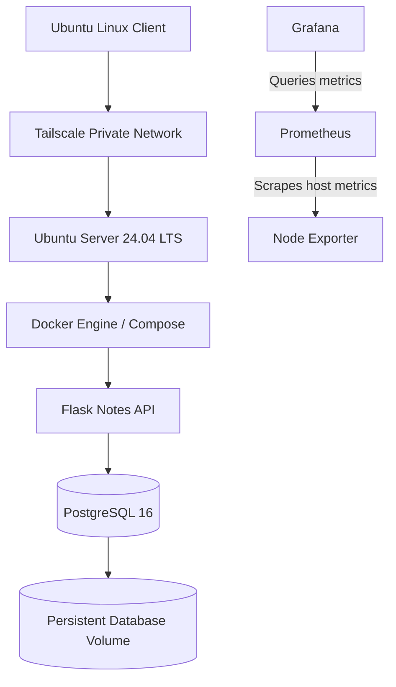
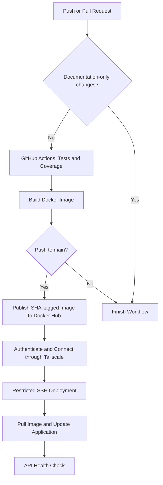

# Homelab DevOps Labs

**Build it. Test it. Break it safely. Understand why it works.**

A hands-on DevOps homelab focused on Linux administration, secure remote access, containerization, database reliability, monitoring, container security, troubleshooting, and CI/CD automation.

This repository documents practical implementation work, architecture decisions, verification results, troubleshooting, and known limitations. The homelab is a learning environment, not a production service.

## Project Goals

- Develop practical Linux server administration and troubleshooting skills.
- Configure secure remote access using Tailscale and SSH.
- Build and operate containerized applications with Docker and Docker Compose.
- Implement and verify PostgreSQL backup and restore procedures.
- Monitor host resources using Prometheus, Node Exporter, and Grafana.
- Scan container images for vulnerabilities and apply runtime hardening.
- Automate application testing, Docker image publishing, and homelab deployment using GitHub Actions.
- Practice deployment verification, failure handling, and recovery.
- Document implementation decisions, operational issues, and security considerations.

## Architecture

### Application and Homelab



Prometheus collects host metrics from Node Exporter. Grafana queries Prometheus to display dashboards and visualize monitoring data.

### CI/CD Deployment Flow



The workflow runs automated tests and builds the application image for applicable repository events. Markdown-only changes are excluded through GitHub Actions path filtering.

Image publishing and deployment are restricted to pushes to `main`. Pull requests run applicable CI checks but do not publish or deploy the application.

The deployment process uses Tailscale for private connectivity and a dedicated SSH key restricted to a server-side deployment script. The script validates the requested image tag, pulls the corresponding image, updates the application service, and checks API health.

Private network details, credentials, and sensitive access configuration are intentionally excluded from this documentation.

## Technology Stack

| Area | Technology |
|---|---|
| Server | Ubuntu Server 24.04 LTS |
| Client | Ubuntu Linux |
| Remote access | Tailscale and SSH |
| CI/CD | GitHub Actions |
| Version control | Git and GitHub |
| Containers | Docker and Docker Compose |
| Application | Flask and Gunicorn |
| Database | PostgreSQL 16 |
| Container registry | Docker Hub |
| Container networking | Docker bridge network |
| Data persistence | Docker named volumes |
| Monitoring | Prometheus and Node Exporter |
| Dashboards and visualization | Grafana |
| Container security | Trivy |
| Documentation | Markdown and Mermaid |

## Labs and Progress

| Lab | Status |
|---|---|
| Linux Server Administration | In progress |
| Tailscale Remote Access | Connectivity, SSH, MagicDNS, startup, and reboot verification completed |
| Docker Networking | Implemented and documented |
| PostgreSQL Backup and Restore | Custom-format backups, isolated restoration, data comparison, and sequence verification completed |
| Docker Compose | Application migration, health checks, runtime security controls, and persistence verification completed |
| Trivy Container Security | Historical image scanning and runtime hardening completed; vulnerability remediation and rescan pending |
| Monitoring | Prometheus, Node Exporter, and Grafana deployed; dashboard and CPU alert-rule testing completed |
| CI/CD | Two successful automated deployments verified; fresh application-code deployment testing and failure recovery pending |

See [ROADMAP.md](ROADMAP.md) for detailed implementation and verification status.

## CI/CD Pipeline

The workflow is defined in `.github/workflows/ci.yml`.

### Continuous Integration

For applicable pushes and pull requests, GitHub Actions:

- Checks out the repository.
- Sets up Python 3.12.
- Installs development dependencies.
- Runs pytest with coverage reporting.
- Builds the application Docker image.

Markdown-only changes are excluded using `paths-ignore` for push and pull-request events. Changes containing both Markdown and application files still trigger the workflow.

The application tests cover health responses, notes retrieval, note insertion, database error handling, and environment-based database configuration. Database connections are mocked in these tests; they do not replace integration testing against a running PostgreSQL instance.

### Image Publishing

On pushes to `main`, the workflow authenticates to Docker Hub and publishes the application image:

`docker.io/sufiyankhan10/homelab-notes-api`

Published images receive a full Git commit SHA tag. The default branch also receives the `latest` tag.

SHA-based tags provide an identifiable reference to the image built from a particular commit.

### Secure Deployment

After successful CI and image publishing for a push to `main`, the workflow:

1. Authenticates to Tailscale using GitHub Actions identity federation.
2. Establishes private connectivity to the homelab server.
3. Configures SSH using GitHub Actions secrets and strict host-key verification.
4. Invokes a restricted server-side deployment script with the requested image tag.
5. Pulls the image and updates the application service through Docker Compose.
6. Waits for the API health check to succeed.

The server-side script accepts only full SHA-tagged image references and updates the application service without intentionally recreating PostgreSQL.

The deployment SSH key is restricted to the deployment command rather than providing a general-purpose interactive shell.

### Deployment Verification

Two automated deployments through GitHub Actions have completed successfully.

The initial deployment verified the end-to-end process, including image publishing, private connectivity, restricted SSH access, application update, and API health.

A subsequent deployment used the image tagged with commit:

`73d5182683bc265d0fb8704804fb3e574cb961ee`

This deployment was triggered by a CI/CD workflow configuration change rather than an application-code change.

Post-deployment verification confirmed:

- The application container was running and reported healthy.
- The running application used the expected commit-SHA image.
- The API health endpoint returned HTTP `200 OK`.
- The health response was `{"status":"ok"}`.
- The notes endpoint returned both existing records.
- PostgreSQL remained healthy and was not recreated during the application update.
- Prometheus, Node Exporter, and Grafana remained running.

The existing application records remained accessible:

```json
[
  {
    "id": 1,
    "txt": "survives container delete"
  },
  {
    "id": 34,
    "txt": "Docker network DNS works"
  }
]
```

**Known limitations:**

- A deployment triggered by a fresh application-code change is still pending.
- Automatic rollback and deployment failure recovery have not been implemented or tested.

## PostgreSQL Backup and Restore

PostgreSQL backup and recovery are treated as separate operational tasks. A successful backup command alone does not establish that data can be recovered.

Implemented work includes:

- Custom-format backups using `pg_dump`.
- Backup archive inspection using `pg_restore`.
- Restoration into isolated temporary databases.
- Comparison of restored records and checksums.
- Sequence-state verification.
- Backup validation and retention controls.
- Startup-triggered backup automation using a systemd oneshot service.

Isolated restoration tests verified restored data and sequence state. The automated backup service also completed successfully on October 31, 2026, creating and validating:

`notes-db-2026-10-31-151557.dump`

**Known limitation:** The backup service runs after server startup with a five-minute delay. It is not a guaranteed daily scheduler if the server remains running for multiple days. Failure notifications and automated retry handling remain future improvements.

See [Lab 04: PostgreSQL Backup and Restore](labs/04-postgresql-backup-restore/README.md) for implementation details and test evidence.

## Monitoring

The monitoring stack consists of:

- **Prometheus:** Metrics collection and alert-rule evaluation.
- **Node Exporter:** Host-level metrics.
- **Grafana:** Dashboards and visualization.

Prometheus scrapes itself and Node Exporter every 15 seconds. Grafana queries Prometheus for dashboard data.

Prometheus and Grafana use persistent Docker volumes. Their web interfaces are bound to localhost and accessed remotely through SSH tunnels. Node Exporter is accessible to Prometheus over the Docker network rather than through a published host port.

Verification includes:

- Prometheus scrape-target checks.
- Node Exporter metrics collection.
- Grafana data-source and dashboard configuration.
- CPU alert-rule validation.
- Pending-to-firing alert-state testing through a controlled threshold simulation.

The configured CPU alert triggers when usage remains above 80% for five minutes.

**Known limitations:** Alert notification delivery has not been configured. The current setup is a single-host learning environment, not a highly available monitoring platform.

See [Lab 07: Monitoring](labs/07-monitoring/README.md) for configuration and verification details.

## Container Security

Trivy is used to scan application images for reported vulnerabilities. The project also covers container runtime hardening and Docker configuration review.

A historical scan of the `notes-app:3` image on October 17, 2026, reported:

- 44 HIGH findings.
- 0 CRITICAL findings.
- 8 unique CVEs.
- All 44 HIGH findings were associated with operating-system packages.
- No HIGH or CRITICAL Python dependency findings.

These results describe that specific historical image scan, not necessarily the current image.

Runtime hardening includes a non-root application user, read-only root filesystem, restricted Linux capabilities, no-new-privileges, and a constrained temporary filesystem.

**Remaining work:** Investigate applicable vendor fixes, rebuild the image after appropriate package updates, and perform a post-remediation scan.

See [Lab 06: Trivy Container Security](labs/06-trivy-container-security/README.md) for the historical findings and hardening details.

## Engineering Approach

Each lab aims to document:

- Objective and problem statement.
- Architecture and implementation.
- Commands and configuration decisions.
- Verification results.
- Troubleshooting and root-cause analysis.
- Security considerations.
- Known limitations and future improvements.

The project follows an evidence-based approach:

- Only verified results are described as completed.
- Planned work and known limitations remain clearly identified.
- Backup and restore procedures are tested rather than assumed to work.
- Security findings are investigated before remediation is attempted.
- Application health and data persistence are checked after changes.
- Deployment credentials are stored as GitHub Actions secrets.
- SSH host-key verification remains enabled.
- Least-privilege access is preferred for remote deployment.
- Public documentation is reviewed for secrets and sensitive infrastructure details.

## Current Issues and Next Steps

- Investigate Wi-Fi latency using measured evidence.
- Investigate and remediate reported container image vulnerabilities.
- Rebuild the application image and perform a post-remediation Trivy scan.
- Configure and test monitoring alert notifications.
- Test automated deployment following a fresh application-code change.
- Implement and test deployment failure handling and rollback.

## Security

This repository is intended for sanitized documentation and safe examples.

Never commit:

- Passwords, API tokens, or other credentials.
- Private SSH keys or sensitive access configuration.
- Logs containing unnecessary sensitive information.
- Database backups containing real or private data.
- Unnecessary private network identifiers or infrastructure details.

Use least privilege, restrict unnecessary network exposure, and verify changes before applying them to running services.

See [SECURITY.md](SECURITY.md) for security guidelines.

## Roadmap

See [ROADMAP.md](ROADMAP.md) for implementation progress, pending verification, and planned milestones.

## Author

**Sufiyan Khan**

DevOps | Linux | Docker | Cloud | CI/CD
