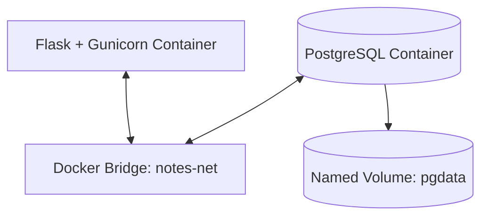

# Docker Networking

## Objective

Run a containerized web application and PostgreSQL database on a
user-defined Docker bridge network, then verify container-to-container
communication using Docker DNS.

## Architecture



## Environment

| Component | Role |
|---|---|
| Flask | Web application |
| Gunicorn | Application server |
| PostgreSQL | Relational database |
| Docker bridge | Container networking |
| Docker DNS | Service-name resolution |
| Named volume | Persistent database storage |

## Implementation

### 1. Create a user-defined network

```bash
docker network create notes-net
```

If the network already exists, inspect it instead of creating a duplicate.

### 2. Inspect the network

```bash
docker network inspect notes-net
```

Check the network configuration and attached containers.

### 3. Verify container status

```bash
docker ps
```

Confirm that the application and database containers are running.

### 4. Verify database name resolution

The application uses the database service/container name:

```text
DB_HOST=db
```

This configuration was used in the lab to connect the application
to PostgreSQL through Docker's internal DNS.

Do not publish actual passwords or environment-file contents.

### 5. Verify the application endpoint

The `/notes` endpoint returned HTTP 200 during testing.

An HTTP 200 response confirms a successful HTTP request. Database
functionality should also be checked using appropriate application
and database-level tests.

## Key Findings

- Containers on a shared user-defined bridge can communicate using
  Docker DNS names.
- An application can use a database container name instead of a
  hard-coded container IP address.
- Container networking and persistent storage are separate concerns.
- Successful HTTP responses are useful evidence, but do not replace
  database integrity and persistence tests.

## Security Considerations

- Keep database credentials out of source control.
- Avoid publishing database ports unless external access is required.
- Use least-privilege database accounts.
- Inspect container configuration before sharing terminal output.
- Never publish real database backups containing sensitive data.

## Follow-up Work

- [x] Document the application and database configuration.
- [x] Migrate the application and database setup to Docker Compose.
- [x] Verify application-to-database connectivity.
- [x] Verify application health and API responses.
- [x] Verify that existing database records survived the Compose migration.

See [Lab 05: Docker Compose](../05-docker-compose/README.md)
for migration and verification details.

## Status

Docker networking and service-name resolution were tested.
The application was subsequently migrated to Docker Compose, and
application functionality and database records were verified.
