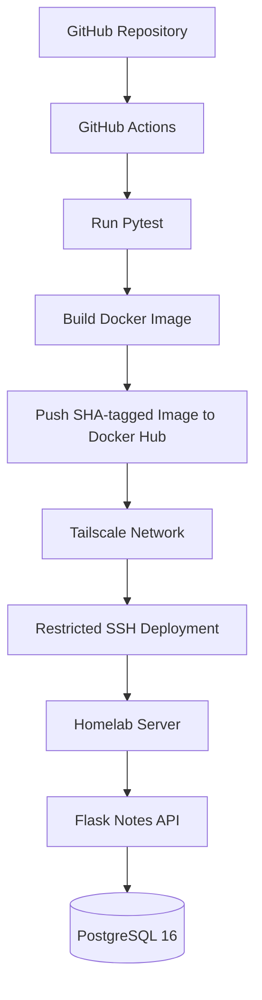

# Lab 05: Docker Compose

## Objective

Migrate a manually managed Flask and PostgreSQL application into a Docker Compose environment while preserving existing database data.

This lab covers container orchestration, service communication, persistent storage, health checks, runtime security, automated testing, Docker image publishing and remote deployment.

## Architecture



### Application Stack

| Component | Configuration |
|---|---|
| Application | Flask Notes API |
| Application server | Gunicorn |
| Python | 3.12 |
| Database | PostgreSQL 16 |
| Container orchestration | Docker Compose |
| Application image | `sufiyankhan10/homelab-notes-api` |
| Application port | `127.0.0.1:5000` |
| Database storage | External Docker volume `pgdata` |
| Docker network | External network `notes-net` |
| Container user | Non-root UID 10001 |

## 1. Docker Compose Configuration

The application and database run as separate services within a shared Docker network.

### Application service

The application uses a prebuilt Docker image specified through the `NOTES_IMAGE` environment variable in the repository's Compose configuration.

```yaml
app:
  image: ${NOTES_IMAGE:?NOTES_IMAGE is required}
  restart: unless-stopped
  read_only: true
  tmpfs:
    - /tmp:rw,noexec,nosuid,size=64m
  cap_drop:
    - ALL
  security_opt:
    - no-new-privileges:true
  environment:
    DB_HOST: db
    DB_NAME: postgres
    DB_USER: postgres
    DB_PASSWORD: ${DB_PASSWORD:?DB_PASSWORD is required}
  depends_on:
    db:
      condition: service_healthy
  ports:
    - "127.0.0.1:5000:5000"
  networks:
    - notes-net
```

### Database service

PostgreSQL uses a persistent Docker volume and a health check based on `pg_isready`.

```yaml
db:
  image: postgres:16
  restart: unless-stopped
  environment:
    POSTGRES_PASSWORD: ${POSTGRES_PASSWORD:?POSTGRES_PASSWORD is required}
  volumes:
    - pgdata:/var/lib/postgresql/data
  networks:
    - notes-net
  healthcheck:
    test: ["CMD-SHELL", "pg_isready -U postgres -d postgres"]
    interval: 10s
    timeout: 5s
    retries: 5
    start_period: 10s
```

### Service communication

- Both services communicate through the external `notes-net` Docker network.
- The application connects to PostgreSQL using the service name `db`.
- Docker Compose waits for the database health check to pass before starting the application.
- The application port is bound to `127.0.0.1:5000`, rather than being exposed on every host network interface.

### Environment configuration

Database credentials are provided through environment variables.

The `.env` file is excluded from Git using `.gitignore`. An `.env.example` file can be committed to document the required configuration without exposing credentials.

Restrict the actual `.env` file permissions:

```bash
chmod 600 .env
```

## 2. Persistent Storage

The database uses an external named Docker volume:

```yaml
volumes:
  pgdata:
    external: true
    name: pgdata
```

The volume is managed independently of the application container lifecycle.

This means recreating or updating the application container does not require recreating the database container or deleting its data volume.

The Docker network is also declared as external:

```yaml
networks:
  notes-net:
    external: true
    name: notes-net
```

## 3. Container Security Hardening

The application container uses several runtime security controls.

| Control | Implementation |
|---|---|
| Non-root execution | UID 10001 |
| Read-only filesystem | `read_only: true` |
| Temporary writable storage | `/tmp` using tmpfs |
| Temporary storage restrictions | `noexec`, `nosuid`, 64 MB limit |
| Linux capabilities | `cap_drop: ALL` |
| Privilege escalation | `no-new-privileges:true` |
| Network exposure | Localhost-only port binding |
| Application workers | Two Gunicorn workers |

The Dockerfile creates a dedicated non-root application user and starts Gunicorn with two workers.

These controls reduce the container's privileges and limit unnecessary writable access.

## 4. Health Checks

Two separate health checks are used.

**PostgreSQL health check**

Docker Compose uses `pg_isready` to check whether PostgreSQL is accepting connections.

**Application health check**

The Dockerfile defines an image-level health check against:

```text
http://127.0.0.1:5000/health
```

The Flask application exposes a health endpoint returning:

```json
{
  "status": "ok"
}
```

The application health endpoint confirms that the Flask API is responding. It does not independently establish PostgreSQL availability; database health is checked separately.

## 5. Automated Testing

GitHub Actions runs the application's pytest suite using Python 3.12.

The workflow executes:

```bash
python -m pytest --cov=app --cov-report=term-missing -v test_app.py
```

The six tests cover:

| Test | Purpose |
|---|---|
| `test_health` | Health endpoint response |
| `test_list_notes` | Retrieving notes |
| `test_add_note` | Inserting a note |
| `test_list_notes_database_error` | Handling database errors during retrieval |
| `test_add_note_database_error` | Handling database errors during insertion |
| `test_get_conn_uses_environment_configuration` | Reading database configuration from environment variables |

Database interactions in these tests are mocked using Python's `unittest.mock`. The suite tests application behavior and error handling without connecting to a live PostgreSQL instance.

## 6. CI/CD Pipeline

The GitHub Actions workflow is located at:

```text
.github/workflows/ci.yml
```

The pipeline automates testing, Docker image creation, publishing and deployment.

### Pipeline stages

1. **Trigger:** Runs on pushes and pull requests, excluding Markdown-only changes.
2. **Testing:** Sets up Python 3.12, installs development dependencies and runs pytest with coverage.
3. **Docker build:** Builds the application image using Docker Buildx.
4. **Image publishing:** On pushes to `main`, authenticates with Docker Hub and publishes the image.
5. **Image tagging:** Publishes a full commit SHA tag and the `latest` tag for the default branch.
6. **Network access:** Connects the GitHub Actions runner to the homelab through Tailscale.
7. **SSH authentication:** Uses a dedicated deployment key and strict host-key verification.
8. **Remote deployment:** Sends the SHA-tagged image identifier to the server-side deployment command.

Pull requests and non-main pushes run the test and build stages without publishing or deploying the image.

### Remote deployment

The deployment command is installed on the homelab server at:

```text
/usr/local/sbin/deploy-notes-app
```

The SSH key is restricted to this deployment command rather than providing general-purpose shell access.

The server-side deployment process:

1. Validates the received SHA tag against the expected format.
2. Exports the validated tag as `NOTES_IMAGE_TAG`.
3. Pulls the corresponding Docker Hub application image.
4. Updates only the application service using:

```bash
docker compose up -d --no-deps app
```

5. Waits for the API health endpoint, retrying for up to approximately 60 seconds.
6. Reports deployment success if the endpoint responds.
7. Prints recent application logs and exits unsuccessfully if the health check fails.

The server uses a deployment-specific Compose configuration with the image reference:

```yaml
image: sufiyankhan10/homelab-notes-api:${NOTES_IMAGE_TAG:?NOTES_IMAGE_TAG is required}
```

This configuration is separate from the tracked repository Compose file, which uses `NOTES_IMAGE`.

The deployment updates the application service without explicitly recreating or updating the PostgreSQL service.

## 7. Deployment Verification

The deployment was verified on the homelab server.

### Application health

```bash
curl -i http://127.0.0.1:5000/health
```

Expected response:

```json
{
  "status": "ok"
}
```

The endpoint returned HTTP 200.

### Notes API

```bash
curl -s http://127.0.0.1:5000/notes
```

The application returned the existing records:

```json
[
  {
    "id": 1,
    "txt": "survives container delete"
  },
  {
    "id": 34,
    "txt": "Docker network DNS works"
  }
]
```

### Container status

```bash
docker compose ps
```

Both the application and PostgreSQL containers were reported healthy during verification.

The deployed application image was also checked against its full SHA-tagged Docker image reference.

Two automated deployments have been verified. The subsequent deployment used a workflow-configuration-only commit, so a fresh application-code deployment remains a separate verification step.

## 8. Backup and Recovery

PostgreSQL backup automation is documented separately:

- [PostgreSQL Backup and Restore](../04-postgresql-backup-restore/README.md)
- [Backup Automation Guide](../../docs/postgres-backup-automation.md)

The backup process uses PostgreSQL custom-format dumps, archive validation, concurrency protection and retention of the seven newest backups.

An isolated database restore test was also performed to verify that backup data could be restored without modifying the running application database.

## 9. Limitations and Next Steps

The current implementation has some remaining work:

- Add integration tests against a real PostgreSQL instance.
- Implement and test automatic rollback for failed deployments.
- Verify deployment following a fresh application-code change.
- Consider workflow concurrency controls to prevent overlapping deployments.
- Evaluate branch-protection behavior before making the workflow a required status check, because Markdown-only changes are excluded from workflow execution.

## 10. Outcome

This lab demonstrates a progression from manually managed application containers to a Docker Compose deployment with:

- Persistent PostgreSQL storage.
- Service discovery and health checks.
- Container runtime hardening.
- Automated Python testing.
- Docker image building and publishing.
- Tailscale-based remote access.
- Restricted SSH deployment.
- Application health verification.
- PostgreSQL backup and recovery practices.

The environment is a personal homelab used for learning and engineering practice, not a production service.
