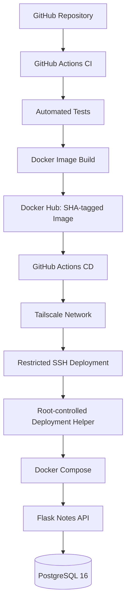

# Lab 05: Docker Compose

## Objective

Migrate a manually managed Flask and PostgreSQL application into a Docker Compose environment while preserving existing database data.

This lab covers container orchestration, service communication, persistent storage, health checks, runtime security, automated testing, Docker image publishing, and remote deployment.

## Architecture



### Application Stack

| Component | Configuration |
|---|---|
| Application | Flask Notes API |
| Application server | Gunicorn |
| Python | 3.12 |
| Database | PostgreSQL 16 |
| Container orchestration | Docker Compose |
| Application image | Public Docker Hub image |
| Application port | `127.0.0.1:5000` |
| Database storage | External Docker volume |
| Docker network | External Docker network |
| Container user | Non-root UID 10001 |

## 1. Docker Compose Configuration

The application and database run as separate services within a shared Docker network.

### Application service

The application uses a prebuilt Docker image specified through the `NOTES_IMAGE` environment variable.

```yaml
app:
  image: ${NOTES_IMAGE:?NOTES_IMAGE is required}
  restart: unless-stopped
  read_only: true
  tmpfs:
    - /tmp:rw,noexec,nosuid,size=64m
  cap_drop:
    - ALL
  security_opt:
    - no-new-privileges:true
  environment:
    DB_HOST: db
    DB_NAME: postgres
    DB_USER: postgres
    DB_PASSWORD: ${DB_PASSWORD:?DB_PASSWORD is required}
  depends_on:
    db:
      condition: service_healthy
  ports:
    - "127.0.0.1:5000:5000"
  networks:
    - notes-net
```

### Database service

PostgreSQL uses persistent storage and a health check based on `pg_isready`.

```yaml
db:
  image: postgres:16
  restart: unless-stopped
  environment:
    POSTGRES_PASSWORD: ${POSTGRES_PASSWORD:?POSTGRES_PASSWORD is required}
  volumes:
    - pgdata:/var/lib/postgresql/data
  networks:
    - notes-net
  healthcheck:
    test: ["CMD-SHELL", "pg_isready -U postgres -d postgres"]
    interval: 10s
    timeout: 5s
    retries: 5
    start_period: 10s
```

### Service communication

- Both services communicate through an external Docker network.
- The application connects to PostgreSQL using the service name `db`.
- Docker Compose waits for the database health check to pass before starting the application.
- The application port is bound to `127.0.0.1:5000`, rather than being exposed on every host network interface.

### Environment configuration

Database credentials are supplied through environment variables.

The `.env` file is excluded from Git using `.gitignore`. An `.env.example` file can document the required configuration without containing actual credentials.

Restrict the permissions of the actual `.env` file:

```bash
chmod 600 .env
```

Never commit real passwords, tokens, private keys, or credential-bearing environment files.

## 2. Persistent Storage

The database uses an external named Docker volume:

```yaml
volumes:
  pgdata:
    external: true
    name: pgdata
```

The volume is managed independently of the application container lifecycle.

Recreating or updating the application container does not require recreating the database container or deleting its data volume.

The Docker network is also declared as external:

```yaml
networks:
  notes-net:
    external: true
    name: notes-net
```

This allows the application and database to use an independently managed network.

**Important:** Never use `docker compose down -v` as routine cleanup for this environment. External database storage must be preserved.

## 3. Container Security Hardening

The application container uses several runtime security controls.

| Control | Implementation |
|---|---|
| Non-root execution | UID 10001 |
| Read-only filesystem | `read_only: true` |
| Temporary writable storage | `/tmp` using tmpfs |
| Temporary storage restrictions | `noexec`, `nosuid`, 64 MB limit |
| Linux capabilities | `cap_drop: ALL` |
| Privilege escalation | `no-new-privileges:true` |
| Network exposure | Localhost-only port binding |
| Application workers | Two Gunicorn workers |

The Dockerfile creates a dedicated non-root application user and starts Gunicorn with two workers.

These controls reduce container privileges and restrict unnecessary writable access.

They are defense-in-depth measures, not a replacement for application security, image scanning, or host-level security.

## 4. Health Checks and Readiness

The application and database use separate health checks.

### PostgreSQL health check

Docker Compose uses `pg_isready` to determine whether PostgreSQL is accepting connections.

### Application health check

The Flask application exposes two relevant endpoints:

| Endpoint | Purpose |
|---|---|
| `/health` | Checks whether the API is responding |
| `/ready` | Checks application readiness, including database connectivity |

The image-level health check uses the application health endpoint.

The deployment process uses the readiness endpoint to verify that the application can serve requests with its database dependency available.

This distinction is important: an API process can respond to a health request while its database connection is unavailable.

## 5. Automated Testing

GitHub Actions runs the application's pytest suite using Python 3.12.

The workflow executes:

```bash
python -m pytest --cov=app --cov-report=term-missing -v test_app.py
```

The tests cover application behavior, including:

- Health and readiness endpoints.
- Retrieving notes.
- Inserting notes.
- Database error handling.
- Reading database configuration from environment variables.

Database interactions in the unit tests are mocked using Python's `unittest.mock`.

The suite verifies application behavior and error handling without requiring a live PostgreSQL instance.

A separate integration-test layer against a real PostgreSQL instance remains a possible improvement.

## 6. CI/CD Pipeline

CI and CD are maintained as separate GitHub Actions workflows.

### Continuous Integration

Workflow:

```text
.github/workflows/ci.yml
```

The CI pipeline:

1. Runs on relevant pushes and pull requests.
2. Sets up Python 3.12.
3. Installs development dependencies.
4. Runs pytest with coverage.
5. Builds the Docker image.
6. Runs the configured container image security scan.
7. Publishes the image to Docker Hub on pushes to `main`.

Published images use a full commit SHA tag and a `latest` tag for the default branch.

Pull requests and non-main pushes run validation without publishing or deploying the image.

### Continuous Deployment

Workflow:

```text
.github/workflows/cd.yml
```

The CD workflow runs after successful CI on `main`.

Its deployment process uses:

1. A GitHub Actions runner.
2. Tailscale connectivity to the homelab.
3. SSH with strict host-key verification.
4. A restricted deployment account.
5. A server-side deployment wrapper and root-controlled helper.
6. A SHA-tagged Docker image.

The deployment account does not require membership in the Docker or sudo groups.

Instead, SSH access is restricted to a specific deployment command. The server validates the requested image tag before invoking the root-controlled deployment helper.

### Remote deployment process

The server-side helper:

1. Validates the supplied SHA-tagged image identifier.
2. Checks that the image belongs to the expected application repository.
3. Pulls the requested image.
4. Updates only the application service using:

```bash
docker compose up -d --no-deps app
```

5. Waits for the expected image to run.
6. Checks application readiness, including database connectivity.
7. Reports success only after the required verification succeeds.

The deployment process also implements rollback.

If deployment or post-deployment health verification fails, the helper attempts to restore the previous application image and verifies the recovered application.

The rollback mechanism was tested by deliberately triggering a health-verification failure. The previous image was restored and returned to a healthy state.

This test validates the rollback mechanism; it does not represent a real application regression.

The PostgreSQL service and its persistent volume are not explicitly recreated as part of an application-only deployment.

## 7. Deployment Verification

The deployment was verified on the homelab server.

### Application readiness

```bash
curl -i http://127.0.0.1:5000/ready
```

The readiness endpoint returned HTTP 200 during successful verification.

### Notes API

```bash
curl -sS http://127.0.0.1:5000/notes
```

The endpoint returned the expected application response, confirming that the API could retrieve records from PostgreSQL.

Actual note contents and database identifiers are intentionally omitted from this public documentation.

### Container status

```bash
docker compose ps
```

Both application and PostgreSQL containers were reported healthy during verification.

The deployed application image was also checked against its full SHA-tagged image reference.

Two automated deployments were previously verified. The subsequent deployment used a workflow-configuration-only commit, so a fresh application-code deployment remains a separate verification step.

## 8. Backup and Recovery

PostgreSQL backup automation and recovery are documented separately:

- [PostgreSQL Backup and Restore](../04-postgresql-backup-restore/README.md)
- [Backup Automation Guide](../../docs/postgres-backup-automation.md)

The repository includes a configurable backup reference script:

`scripts/backup-postgres.sh`

It uses Docker Compose service discovery to locate the database container instead of relying on a hardcoded container name.

The script supports configuration through environment variables:

- `COMPOSE_FILE` — Compose configuration file.
- `DB_SERVICE` — database service name (default: `db`).
- `DB_NAME` and `DB_USER` — PostgreSQL database and user.
- `BACKUP_DIR` — backup destination.
- `RETENTION_COUNT` — number of matching archives to retain (default: `7`).

The reference script includes:

- PostgreSQL custom-format dumps.
- Database readiness checks.
- Archive validation with `pg_restore --list`.
- Concurrency protection using `flock`.
- Temporary files and atomic file replacement.
- Configurable retention of the newest matching backups.

**Deployment distinction:** The repository script is a lab/reference implementation. The deployed homelab backup uses a separately installed root-owned script managed by a systemd oneshot service. The repository script is not automatically deployed to the server.

The deployed implementation uses a startup-triggered service with a five-minute delay, same-day duplicate prevention, and seven-file retention. It does not currently guarantee a recurring daily backup while the server remains online.

An isolated PostgreSQL restore test was also performed to verify that backup data could be recovered without modifying the running application database.

Archive validation and an actual restore test provide different levels of recovery evidence. A valid archive listing alone does not prove that a database can be successfully restored.

## 9. Limitations and Next Steps

The current implementation has some remaining improvement opportunities:

- Add integration tests against a real PostgreSQL instance.
- Verify deployment following a fresh application-code change.
- Continue testing rollback under different failure scenarios.
- Evaluate branch-protection behavior before making workflow checks required, because Markdown-only changes are excluded from workflow execution.
- Consider off-host backup storage to improve resilience against server or disk failure.
- Expand recovery testing beyond basic archive validation and row-count checks.

The environment is a personal homelab used for learning and engineering practice, not a production service.

## 10. Outcome

This lab demonstrates a progression from manually managed application containers to a Docker Compose deployment with:

- Persistent PostgreSQL storage.
- Service discovery and health checks.
- Container runtime hardening.
- Automated Python testing.
- Docker image building and publishing.
- Tailscale-based remote access.
- Restricted SSH deployment.
- Root-controlled deployment operations.
- Application readiness verification.
- Tested deployment rollback.
- PostgreSQL backup and recovery practices.

The implementation provides practical experience with container orchestration, application deployment, infrastructure security, and operational recovery.
