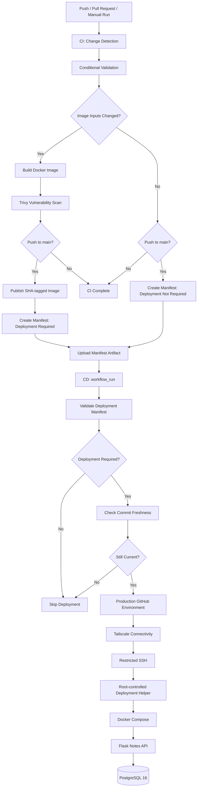

# Lab 05: Docker Compose

## Objective

Migrate a manually managed Flask and PostgreSQL application into a Docker Compose environment while preserving existing database data.

This lab covers container orchestration, service communication, persistent storage, health checks, runtime security, automated testing, Docker image publishing, CI/CD automation, and restricted remote deployment.

## Architecture



The manifest is generated for pushes to `main`. Pull requests and manual runs can execute applicable CI validation but do not generate a production deployment request.

### Application Stack

| Component | Configuration |
|---|---|
| Application | Flask Notes API |
| Application server | Gunicorn |
| Python | 3.12 |
| Database | PostgreSQL 16 |
| Container orchestration | Docker Compose |
| Application image | Docker Hub image |
| Application port | `127.0.0.1:5000` |
| Database storage | External Docker volume |
| Docker network | External Docker network |
| Container user | Non-root UID 10001 |

## 1. Docker Compose Configuration

The application and database run as separate services within a shared Docker network.

### Application service

The application uses a prebuilt Docker image specified through the `NOTES_IMAGE` environment variable.

```yaml
app:
  image: ${NOTES_IMAGE:?NOTES_IMAGE is required}
  restart: unless-stopped
  read_only: true
  tmpfs:
    - /tmp:rw,noexec,nosuid,size=64m
  cap_drop:
    - ALL
  security_opt:
    - no-new-privileges:true
  environment:
    DB_HOST: db
    DB_NAME: postgres
    DB_USER: postgres
    DB_PASSWORD: ${DB_PASSWORD:?DB_PASSWORD is required}
  depends_on:
    db:
      condition: service_healthy
  ports:
    - "127.0.0.1:5000:5000"
  networks:
    - notes-net
```

### Database service

PostgreSQL uses persistent storage and a health check based on `pg_isready`.

```yaml
db:
  image: postgres:16
  restart: unless-stopped
  environment:
    POSTGRES_PASSWORD: ${POSTGRES_PASSWORD:?POSTGRES_PASSWORD is required}
  volumes:
    - pgdata:/var/lib/postgresql/data
  networks:
    - notes-net
  healthcheck:
    test: ["CMD-SHELL", "pg_isready -U postgres -d postgres"]
    interval: 10s
    timeout: 5s
    retries: 5
    start_period: 10s
```

### Service communication

- Both services communicate through an external Docker network.
- The application connects to PostgreSQL using the service name `db`.
- Docker Compose waits for the database health check to pass before starting the application.
- The application port is bound to `127.0.0.1:5000`, rather than being exposed on every host network interface.

### Environment configuration

Database credentials are supplied through environment variables.

The `.env` file is excluded from Git using `.gitignore`. An `.env.example` file can document the required configuration without containing actual credentials.

Restrict the permissions of the actual `.env` file:

```bash
chmod 600 .env
```

Never commit real passwords, tokens, private keys, or credential-bearing environment files.

## 2. Persistent Storage

The database uses an external named Docker volume:

```yaml
volumes:
  pgdata:
    external: true
    name: pgdata
```

The volume is managed independently of the application container lifecycle.

Recreating or updating the application container does not require recreating the database container or deleting its data volume.

The Docker network is also declared as external:

```yaml
networks:
  notes-net:
    external: true
    name: notes-net
```

This allows the application and database to use an independently managed network.

**Important:** Never use `docker compose down -v` as routine cleanup for this environment. External database storage must be preserved.

## 3. Container Security Hardening

The application container uses several runtime security controls.

| Control | Implementation |
|---|---|
| Non-root execution | UID 10001 |
| Read-only filesystem | `read_only: true` |
| Temporary writable storage | `/tmp` using tmpfs |
| Temporary storage restrictions | `noexec`, `nosuid`, 64 MB limit |
| Linux capabilities | `cap_drop: ALL` |
| Privilege escalation | `no-new-privileges:true` |
| Network exposure | Localhost-only port binding |
| Application workers | Two Gunicorn workers |

The Dockerfile creates a dedicated non-root application user and starts Gunicorn with two workers.

The image also removes the pip package manager after installing the application dependencies.

These controls reduce container privileges and restrict unnecessary writable access.

They are defense-in-depth measures, not a replacement for application security, image scanning, or host-level security.

## 4. Health Checks and Readiness

The application and database use separate health checks.

### PostgreSQL health check

Docker Compose uses `pg_isready` to determine whether PostgreSQL is accepting connections.

### Application health and readiness endpoints

The Flask application exposes two relevant endpoints:

| Endpoint | Purpose |
|---|---|
| `/health` | Checks whether the API process is responding |
| `/ready` | Checks application readiness, including database connectivity |

The `/health` endpoint confirms that the Flask application can respond to a request.

The `/ready` endpoint attempts a database connection and executes:

```sql
SELECT 1;
```

It returns:

- HTTP 200 when the database check succeeds.
- HTTP 503 when the database is unavailable.

The Docker image health check uses `/ready`, so container health reflects both application availability and database connectivity.

This distinction is important: an API process can respond to a health request while its database connection is unavailable.

The unit tests cover both readiness outcomes using mocked database connections. They verify application behavior but do not replace an integration test against a live PostgreSQL instance.

## 5. Automated Testing

The project includes a pytest suite for the Flask application.

The test command is:

```bash
python -m pytest --cov=app --cov-report=term-missing -v test_app.py
```

The tests cover application behavior, including:

- Health and readiness endpoints.
- Successful database readiness checks.
- Database-unavailable readiness responses.
- Retrieving notes.
- Inserting notes.
- Database error handling.
- Reading database configuration from environment variables.

Database interactions in the unit tests are mocked using Python's `unittest.mock`.

The suite verifies application behavior and error handling without requiring a live PostgreSQL instance.

A separate integration-test layer against a real PostgreSQL instance remains a possible improvement.

## 6. CI/CD Pipeline

CI and CD are maintained as separate GitHub Actions workflows:

```text
.github/workflows/ci.yml
.github/workflows/cd.yml
```

The workflows use change detection so that validation and image operations run only when their relevant inputs change.

### Continuous Integration

The CI workflow is triggered by:

- Pushes affecting `labs/05-docker-compose/**` or either CI/CD workflow file.
- Pull requests affecting the same paths.
- Manual runs through `workflow_dispatch`.

The workflow checks out the repository with full Git history and classifies changed files.

It then sets conditional outputs to determine which validation and image operations are required.

### Change detection and conditional validation

| Changed files | Conditional operation |
|---|---|
| `app.py`, `test_app.py`, or application dependency inputs | Run application tests |
| Dependency input or lock files | Validate dependency lock files |
| `compose.yaml` | Validate Docker Compose configuration |
| `scripts/backup-postgres.sh` | Run Bash syntax validation |
| `Dockerfile`, `app.py`, `requirements.txt`, or `.dockerignore` | Build and scan a new application image |

The workflow performs the following checks:

**1. Application tests**

When application or dependency inputs change, CI:

- Sets up Python 3.12.
- Installs development dependencies.
- Runs pytest with coverage reporting.

**2. Dependency lock-file validation**

When dependency inputs or lock files change, CI:

- Creates an isolated Python virtual environment.
- Installs `pip-tools==7.6.2`.
- Regenerates production and development dependency lock files.
- Uses hashes and the `--no-upgrade` option.
- Uses an explicit package index URL for consistent lock generation.
- Compares the generated files against the committed lock files.

The workflow fails if the committed lock files do not match the generated output.

**3. Docker Compose validation**

When `compose.yaml` changes, CI runs:

```bash
docker compose -f compose.yaml config --quiet
```

CI-only placeholder values are supplied for required environment variables. No actual application credentials are used.

**4. Backup script validation**

When the PostgreSQL backup script changes, CI runs:

```bash
bash -n labs/05-docker-compose/scripts/backup-postgres.sh
```

This checks Bash syntax without executing the backup operation.

### Conditional Docker Image Build

The application image is rebuilt only when an image-related input changes:

- `Dockerfile`
- `app.py`
- `requirements.txt`
- `.dockerignore`

Docker Buildx is used to build the image from:

```text
labs/05-docker-compose
```

The build loads the image into the runner's Docker daemon so that the following vulnerability scan can inspect it.

### Image Tagging

The workflow generates:

- A full Git commit SHA tag using the `sha-` prefix.
- A `latest` tag for the default branch.

The SHA tag provides an immutable reference to the source commit used to build the image.

For example:

```text
<dockerhub-namespace>/<image-name>:sha-<full-commit-sha>
```

### Trivy Vulnerability Scanning

When an image-related input changes, CI installs Trivy version `0.70.0`.

The workflow downloads the release archive and its checksum file, verifies the archive using SHA-256, and installs the Trivy binary.

The image scan checks:

- Operating-system packages.
- Application libraries.
- CRITICAL vulnerabilities.
- HIGH vulnerabilities.

The scan is configured to ignore unfixed vulnerabilities and fail the workflow when matching findings are detected.

The scan uses the locally built SHA-tagged image before publishing.

### Docker Hub Publishing

Publishing takes place only when:

- An image-related input has changed.
- The event is a push.
- The target branch is `main`.
- The image scan completes successfully.

Docker Hub credentials are supplied through GitHub Actions secrets.

Pull requests and non-main pushes can run applicable validation, build, and scan operations, but do not publish the image.

### Deployment Manifest

For every push to `main` that triggers CI, the workflow creates a JSON deployment manifest and uploads it as an artifact.

The manifest records:

| Field | Purpose |
|---|---|
| `schema_version` | Manifest format version |
| `repository` | GitHub repository identity |
| `commit_sha` | Exact source commit |
| `deploy_required` | Whether an application deployment is required |
| `image_ref` | Exact SHA-tagged image reference, or `null` |

When an image-related input changes:

- `deploy_required` is `true`.
- `image_ref` contains the exact SHA-tagged image built by CI.

When no image-related input changes:

- `deploy_required` is `false`.
- `image_ref` is `null`.

This allows documentation-only or workflow-only changes to complete CI without requesting an application deployment.

The manifest is associated with the exact CI run and commit. The CD workflow consumes it as data and does not execute files from the artifact.

### Continuous Deployment

The CD workflow is triggered when the CI workflow completes.

It proceeds only when:

- CI completed successfully.
- The originating event was a push.
- The originating branch was `main`.
- The originating repository is the current repository.

The preparation job downloads the manifest from the exact CI run and validates:

- The manifest contains the expected keys.
- The schema version is supported.
- The repository matches the current repository.
- The commit SHA matches the originating CI run.
- The deployment flag is a Boolean.
- The image reference matches the expected SHA-tagged image when deployment is required.
- The image reference is `null` when deployment is not required.

### Stale-Deployment Protection

Before deployment, CD checks that the originating CI commit is still part of the current `main` history.

It also checks whether newer image-relevant changes have been committed after that CI run.

If a newer image-related change is found, the older deployment request is skipped.

The deployment job repeats the freshness check immediately before connecting to the homelab. This reduces the chance of deploying an outdated application image.

The deployment job also uses a production concurrency group with cancellation disabled, preventing production deployment jobs from cancelling one another.

The final GitHub-side freshness check does not eliminate every possible race between the check and the remote deployment command. Server-side stale-deployment enforcement would provide an additional safeguard.

### Restricted Homelab Deployment

When deployment is required and the freshness checks pass, CD:

1. Uses a production GitHub Environment.
2. Validates the required deployment configuration.
3. Establishes private connectivity through the Tailscale GitHub Action.
4. Uses GitHub Actions identity federation for Tailscale authentication.
5. Configures SSH using the deployment private key and known-hosts data stored as GitHub Actions secrets.
6. Enforces strict host-key verification and non-interactive SSH options.
7. Sends only the exact `sha-<40-character-commit>` identifier to the restricted deployment account.

The deployment account does not require general Docker-group or sudo-group membership.

Instead, SSH access is restricted to a specific deployment command. The server-side wrapper validates the requested SHA identifier before invoking the root-controlled deployment helper.

### Remote Deployment Process

The server-side deployment helper is responsible for:

1. Validating the supplied SHA-tagged image identifier.
2. Checking that the image belongs to the expected application repository.
3. Pulling the requested image.
4. Updating only the application service:

```bash
docker compose up -d --no-deps app
```

5. Waiting for the expected image to run.
6. Checking application readiness, including database connectivity.
7. Reporting success only after the required verification succeeds.

The deployment helper contains rollback handling. If deployment or post-deployment health verification fails, it attempts to restore the previous application image and verify the recovered application.

A controlled rollback test was performed using a deliberately triggered health-verification failure. The rollback path was exercised to verify recovery behavior.

The PostgreSQL service and its persistent volume are not explicitly recreated as part of an application-only deployment.

### Workflow Validation Status

The workflow files were checked locally using `actionlint` version `1.7.12`.

Both workflow files passed without reported errors.

The following static check also completed successfully:

```bash
git diff --check
```

The workflow-hardening change was committed and pushed to `main`.

The initial workflow-only run completed successfully. Because no Docker image inputs had changed, image-related operations and application deployment were correctly skipped.

A subsequent dependency lockfile change exposed an inconsistency in the generated lock-file command headers. The lock generation process was corrected using `pip-tools==7.6.2` and an explicit package index URL. The generated command headers changed, while the dependency pins and hashes remained unchanged.

The corrected lock files passed CI validation.

### End-to-End CI/CD Verification

A subsequent lockfile-triggered run exercised the complete image-changing CI/CD path.

The verified sequence included:

1. Application tests and dependency lock-file validation.
2. Docker image build.
3. Trivy installation and checksum verification.
4. Vulnerability scanning of the locally built image.
5. Docker Hub publishing after successful scanning.
6. Deployment manifest generation and validation.
7. CD freshness checks.
8. Tailscale connectivity and restricted SSH deployment.
9. Deployment of the exact SHA-tagged image produced by CI.
10. Post-deployment application health and readiness checks.

Both CI and CD completed successfully.

The deployed application returned:

| Endpoint | Result |
|---|---|
| `/health` | HTTP 200 — `{"status":"ok"}` |
| `/ready` | HTTP 200 — `{"status":"ready"}` |

The deployed image reference was checked against the expected SHA-tagged image. The application and PostgreSQL containers were also reported healthy.

**Verification distinction:** This successful run was triggered by a dependency lockfile change, not a direct `app.py` change. It nevertheless exercised the complete image build, scan, publish, and remote deployment path.

The separate controlled rollback test also verified the deployment helper's rollback behavior.

## 7. Deployment Verification

### Previous Homelab Deployment

The homelab application had previously been deployed using an earlier CI/CD implementation.

Earlier deployment checks confirmed successful application deployment and access to the existing PostgreSQL-backed application data.

The deployed application image was checked against its SHA-based image reference.

These results document earlier deployment work and provide historical context for the current implementation.

### Application Readiness

The current application provides two separate endpoints:

```bash
curl -i http://127.0.0.1:5000/health
```

```bash
curl -i http://127.0.0.1:5000/ready
```

The `/health` endpoint checks whether the API process is responding.

The `/ready` endpoint checks database connectivity and returns HTTP 200 when ready or HTTP 503 when the database is unavailable.

### Notes API

The Notes API can be checked using:

```bash
curl -sS http://127.0.0.1:5000/notes
```

Earlier verification confirmed that the API could retrieve records from PostgreSQL.

Actual note contents and database identifiers are intentionally omitted from this public documentation.

### Container Status

Container status can be inspected using:

```bash
docker compose ps
```

Both application and PostgreSQL containers were reported healthy during the latest deployment verification.

The application health check uses `/ready`, so a healthy application container also indicates that its database readiness check is succeeding at the time of the check.

### Verification Summary

The current verification evidence covers:

| Area | Status |
|---|---|
| CI workflow validation | Verified |
| CD workflow validation | Verified |
| Dependency lock-file validation | Verified |
| Application unit tests | Verified |
| Docker image build | Verified |
| Trivy installation and checksum validation | Verified |
| Image vulnerability scan | Verified |
| Docker Hub publishing | Verified |
| Deployment manifest validation | Verified |
| Stale-deployment checks | Exercised |
| Tailscale connectivity | Verified |
| Restricted SSH deployment | Verified |
| Exact SHA-tagged image deployment | Verified |
| Application health endpoint | HTTP 200 |
| Application readiness endpoint | HTTP 200 |
| Application and database container health | Verified |
| Controlled rollback test | Verified |

The successful image-changing run was triggered by a dependency lockfile update. A direct application-code change deployment is not claimed as part of that specific test.

## 8. Backup and Recovery

PostgreSQL backup automation and recovery are documented separately:

- [PostgreSQL Backup and Restore](../04-postgresql-backup-restore/README.md)
- [Backup Automation Guide](../../docs/postgres-backup-automation.md)

The repository includes a configurable backup reference script:

```text
scripts/backup-postgres.sh
```

It uses Docker Compose service discovery to locate the database container instead of relying on a hardcoded container name.

The script supports configuration through environment variables:

- `COMPOSE_FILE` — Compose configuration file.
- `DB_SERVICE` — database service name (default: `db`).
- `DB_NAME` and `DB_USER` — PostgreSQL database and user.
- `BACKUP_DIR` — backup destination.
- `RETENTION_COUNT` — number of matching archives to retain (default: `7`).

The reference script includes:

- PostgreSQL custom-format dumps.
- Database readiness checks.
- Archive validation with `pg_restore --list`.
- Concurrency protection using `flock`.
- Temporary files and atomic file replacement.
- Configurable retention of the newest matching backups.

**Deployment distinction:** The repository script is a lab/reference implementation. The deployed homelab backup uses a separately installed root-owned script managed by a systemd oneshot service. The repository script is not automatically deployed to the server.

The deployed implementation uses a startup-triggered service with a five-minute delay, same-day duplicate prevention, and seven-file retention.

It does not currently guarantee a recurring daily backup while the server remains online.

The latest verified backup archive was created on November 7, 2026. Its custom-format archive listing was validated successfully using `pg_restore --list`.

Seven archives were retained at the time of inspection. This should not be interpreted as seven consecutive daily backups.

Separate isolated PostgreSQL restore tests were performed to verify that backup data could be recovered without modifying the running application database.

Archive validation and an actual restore test provide different levels of recovery evidence. A valid archive listing alone does not prove that a database can be successfully restored.

## 9. Limitations and Next Steps

The current implementation has the following remaining work:

- Deploy and verify a direct application-code change through the complete CI/CD pipeline.
- Add integration tests against a real PostgreSQL instance.
- Consider pinning third-party GitHub Actions to verified full commit SHAs instead of relying only on version tags.
- Consider stronger server-side protection against stale deployments to reduce the remaining race window between the final GitHub freshness check and remote deployment.
- Evaluate off-host backup storage to improve resilience against server or disk failure.
- Improve backup scheduling so that backups can run regularly even when the server remains online.
- Expand recovery testing beyond archive validation and basic row-count checks.
- Complete base-image and operating-system package remediation for historical Trivy findings, then perform a fresh scan.
- Continue monitoring and validate additional alert-notification scenarios.

The environment is a personal homelab used for learning and engineering practice, not a production service.

## 10. Outcome

This lab demonstrates the development and operation of a self-hosted Flask and PostgreSQL application environment using Docker Compose, with:

- Persistent PostgreSQL storage.
- Service discovery and health checks.
- Container runtime hardening.
- Automated Python testing.
- Change-aware GitHub Actions CI/CD workflows.
- Conditional Docker image building and Trivy vulnerability scanning.
- Full Git SHA-based image tagging and Docker Hub publishing.
- Deployment manifests connecting CI and CD.
- Stale-deployment checks before remote deployment.
- Tailscale-based private connectivity.
- Restricted SSH deployment.
- Root-controlled deployment operations.
- Application readiness verification.
- PostgreSQL backup and recovery practices.
- Prometheus, Node Exporter, and Grafana monitoring.
- Controlled rollback testing.

The complete image-changing CI/CD path has been exercised successfully using a dependency lockfile change. The resulting image was built, scanned, published, and deployed through the hardened workflow. Application health, database readiness, and container status were verified after deployment.

The deployment helper's rollback behavior was also exercised through a controlled failure scenario.

Remaining work is focused on direct application-code deployment verification, stronger backup resilience, integration testing, and remediation of historical image vulnerabilities.

This project provides practical experience with Linux administration, containerization, CI/CD design, infrastructure security, monitoring, database reliability, and deployment operations in a personal homelab environment.
